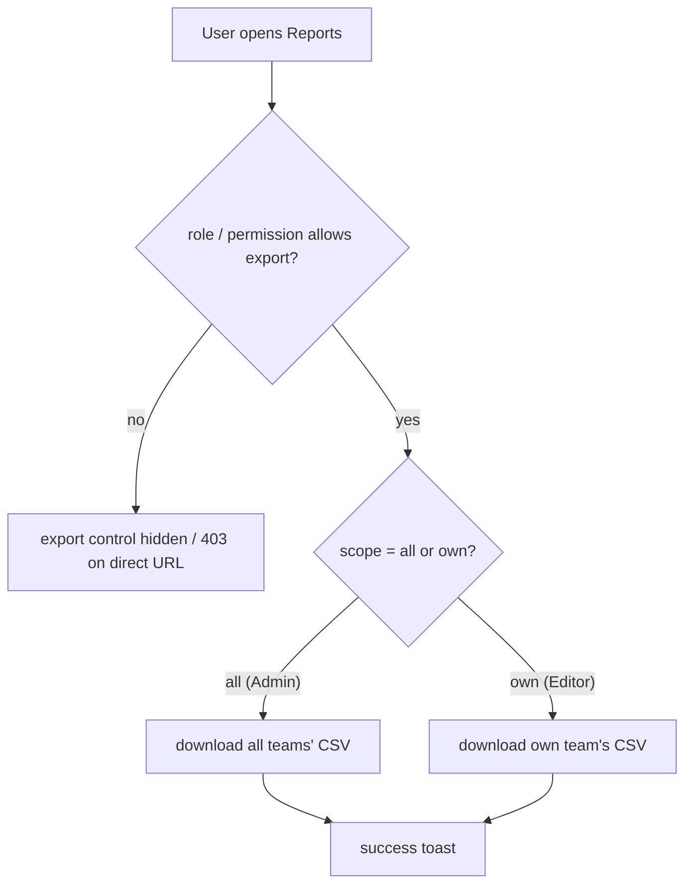

# IMPLEMENTATION PLAN FORMAT - MANDATORY

## ⚠️ CRITICAL: Each story is written as an individual file — follow exactly

---

## 🔢 SEQUENTIAL NUMBERING - NEVER RESET

**Rule**: Epic/story numbers MUST continue sequentially across entire project.

- ✅ Greenfield initial: Epic 1, Story 1.1
- ✅ Adding features: Continue from last (Epic 3.5 → 3.6 or Epic 4.1)
- ✅ Brownfield: ALWAYS continue from last
- ❌ NEVER reset to Epic 1, Story 1.1 (except first plan)

**Determine Starting Numbers**:

1. Manual: Check `docs/plans/implementation-plan.md` + `docs/plans/stories/` for highest numbers
2. Ask user: "Found Epic X, Story X.Y. Start from Epic [N], Story [N.M]? (yes/no)"

**Why**: Maintains history, prevents conflicts, avoids overwrites

---

## 🔀 VERTICAL FEATURE SLICES (MANDATORY)

**Rule**: Order by FEATURE, not LAYER

- ✅ Epic 1: Foundation (FE+BE scaffolding, connection test)
- ✅ Epic 2+: One feature end-to-end (BE API → FE UI → Integration)
- ✅ Testable after each epic

**❌ WRONG (Horizontal)**:
```
Epic 1: All Backend (webhook, LLM, DB)
Epic 2: All Frontend (dashboard, components)
Epic 3: Integration
Problem: Nothing works until Epic 3
```

**✅ CORRECT (Vertical)**:
```
Epic 1: Foundation
  1.1: BE Skeleton (Express, health)
  1.2: FE Skeleton (React, routing)
  1.3: Connect (health check displayed)
  ✅ TESTABLE: "Backend Connected" on homepage

Epic 2: Webhook Pipeline (Complete Feature)
  2.1: Webhook Receiver (BE)
  2.2: LLM Analyzer (BE)
  2.3: Comment Poster (BE)
  2.4: Dashboard UI (FE)
  2.5: Integration Test
  ✅ TESTABLE: PR → analysis → comment → dashboard
```

**Story Order Within Epic**: Backend → Frontend → Integration

**Why**: Testable after each epic, early feedback, low risk, clear progress

---

## 📊 STORY-DEPENDENCY GRAPH (MANDATORY when plan has 2+ stories)

**Rule**: Whenever an implementation plan contains 2 or more stories, the plan workflow MUST also produce a machine-readable dependency graph at `docs/plans/dependency-graph.yml`. The graph groups stories into **waves of independent work** so a team (or solo dev) can pick the next safe-to-start story without analysis paralysis, and so Jira / GitHub Projects / Azure DevOps Boards can tag every story with its wave for board-level visibility.

**The graph does NOT route work to specific developers.** It declares which stories are independent. Routing is a human / board decision: anyone on the team can pick any story in the current wave.

### Artifact: `docs/plans/dependency-graph.yml`

```yaml
version: 1
generated_by: AIRE_PRODUCT_OWNER
generated_at: [YYYY-MM-DD]

team_size: 2
# Number of developers working on this project. Asked once during the plan
# workflow. Used as a story-granularity hint: the planner aims to split
# stories so each wave contains at least `team_size` independent stories
# where the architecture allows. Also drives wave workload distribution
# (Step 10) — each dev gets ~(wave_stories / team_size) stories per wave.


shared_files:
  # Files that two or more stories may touch. Stories writing to these
  # files cannot run truly concurrently across branches without a merge
  # conflict — they are sequenced by the wave assignment.
  - package.json
  - tsconfig.base.json
  - backend/src/routes.ts
  - frontend/src/router.tsx
  - backend/migrations/

stories:
  - id: 1.0
    title: Root tooling seed (monorepo config, lint, tsconfig base)
    epic: 1
    jira: LOCAL                # Updated to PROJ-XXX after Jira export
    github: null               # Updated to issue number after GitHub export
    azure_devops: null         # Updated to work item ID after Azure DevOps export
    wave: 1
    requires: []
    enables: [1.1, 1.2, 1.3]
    files_touched:
      - package.json
      - tsconfig.base.json
      - .eslintrc.cjs
      - .prettierrc
      - .env.example
      - .gitignore
      - README.md

  - id: 1.1
    title: Backend skeleton
    epic: 1
    jira: LOCAL
    github: null
    azure_devops: null
    wave: 2
    requires: [1.0]
    enables: [2.1]
    files_touched:
      - backend/package.json
      - backend/tsconfig.json
      - backend/src/server.ts
      - backend/src/app.ts
      - backend/src/routes.ts

  - id: 1.2
    title: Frontend skeleton
    epic: 1
    jira: LOCAL
    github: null
    azure_devops: null
    wave: 2
    requires: [1.0]
    enables: [2.2]
    files_touched:
      - frontend/package.json
      - frontend/src/main.tsx
      - frontend/src/App.tsx
      - frontend/src/router.tsx

waves:
  - wave: 1
    stories: [1.0]
    assignments:
      # Computed by plan workflow Step 10 — round-robin across team_size.
      # Advisory only: devs may swap stories freely before starting.
      # Prevents accidental same-file edits across concurrent branches.
      - dev: 1
        stories: [1.0]

  - wave: 2
    stories: [1.1, 1.2]
    assignments:
      - dev: 1
        stories: [1.1]
      - dev: 2
        stories: [1.2]
```

### Schema Rules

1. **Every story has a `wave: N` field.** Same value as the wave it appears in inside the `waves:` block. This is the value pushed to Jira (`wave-N` label), GitHub (`wave:N` label), and Azure DevOps (`wave-N` tag).
2. **`requires` is a list of story IDs that MUST be Done before this story starts.** Empty array if root-independent.
3. **`enables` is the reverse edge** — informational, derived from `requires`.
4. **`files_touched` lists every file the story will create or modify.** Used for merge-conflict detection.
5. **`shared_files` lists files that appear in 2+ stories' `files_touched`** — they are allowed to overlap, but stories writing to them cannot be in the same wave on different branches without a merge conflict (see Disjoint-Files Contract below).
6. **`jira`, `github`, and `azure_devops` are the export keys** — `LOCAL` / `null` before export, updated by the export step in `aire-greenfield-plan` / `aire-brownfield-plan`.
7. **`assignments:` block inside each wave entry** — computed by the plan workflow Step 10 using round-robin distribution across `team_size`. Purpose: surfaces which dev implements which stories so no dev idles, and prevents accidental same-file edits across concurrent branches. **Advisory at planning time** (the user may swap/reassign during Step 10), but **binding once a dev declares their slot** in `aire-dev-implement` — that run may implement only the declared dev's stories (absolute lock; reassignment requires re-running the plan workflow). Do NOT add `assignee` fields to individual stories — the `assignments:` block lives at the wave level only.


### Wave Derivation Rule

- **Wave 1** = all stories with `requires: []`.
- **Wave N+1** = all stories whose `requires` are entirely satisfied by waves ≤ N.
- The `waves:` block is regenerated whenever the graph changes.

### Disjoint-Files Contract (the core merge-safety guarantee)

For ANY two stories in the same wave:

1. Their `files_touched` lists MUST be disjoint, OR
2. Every overlapping file MUST be in `shared_files` AND must already exist in the repo (so the merge is a 3-way text merge, not a create-vs-create conflict).

**Seed-wave rule (BLOCKING — prevents the #1 real-world failure mode):**
Any file in `shared_files` that does NOT yet exist in the repo must be **created** in a single "seed" story in wave 1, with all other wave-1 stories `requires`-ing it. Two branches both creating `package.json` produce an unmergeable conflict because git has no common ancestor. The seed story collapses that creation onto one branch first.

### Per-Story Header — Required Fields

Every story file's header MUST mirror the graph entry by adding these lines:

```
**Wave**: N
**Requires**: [1.1, 1.2]
**Enables**: [2.1]
**Files Touched**:
  - src/web/health-check.tsx
  - src/web/App.tsx
```

`Wave` is the column the board uses for filtering ("show me everything in wave 3"). `Requires` and `Enables` give the human reader the same picture without opening the YAML.

### Runtime Working Directory

`docs/plans/.parallel/` is a runtime-only directory created by `aire-dev-implement` when a wave is run in-one-go. It holds the blackboard signals the orchestrator and Status Aggregator read:

```
docs/plans/.parallel/
├── story-N.M/                  ← per-story working dir (only for decomposed stories)
│   ├── tasks.json              ← decompose-lead output (component plan)
│   ├── task-<id>-done.json     ← one per component worker
│   └── integration-done.json   ← integrator signal
└── story-N.M-done.json         ← FINAL per-story completion signal
                                   (written by the integrator, or by the single-agent
                                    for atomic stories) — this is what the aggregator reads
```

It MUST be excluded from git:

```
# .gitignore entry — add during plan workflow Step 10 if not already present
docs/plans/.parallel/
```

The plan workflow (Step 10) must verify this entry exists in `.gitignore` and add it if missing before writing any `assignments:` data.

### Wave Workload Distribution Table

The plan workflow also produces a **Wave Workload Distribution** table (Step 10) and appends it to the `## Dependency Graph` section in `implementation-plan.md` directly after the Mermaid diagram. It shows how stories are distributed across developers per wave so no dev idles:

```
📊 Wave Workload Distribution (team_size: N)

| Wave | Stories | Per Dev | Dev Assignments                                             | Notes                             |
|------|---------|---------|-------------------------------------------------------------|-----------------------------------|
| 1    | 6       | 2 each  | Dev-1: [1.1, 1.2] / Dev-2: [1.3, 1.4] / Dev-3: [1.5, 1.6] | ✅ All devs active               |
| 2    | 4       | 1–2     | Dev-1: [2.1, 2.2] / Dev-2: [2.3] / Dev-3: [2.4]           | ✅ All devs active               |
| 3    | 2       | 1 or 0  | Dev-1: [3.1] / Dev-2: [3.2] / Dev-3: —                     | ⚠️ 1 dev idles (arch constraint) |
```

- ⚠️ rows flag waves where architecture forces fewer stories than `team_size` — acceptable only when no split is possible.
- The `assignments:` blocks in `dependency-graph.yml` mirror this table exactly.
- Devs may swap stories freely; the table is advisory.

### Mermaid Mirror

The implementation plan adds a `## Dependency Graph` section at the top with a Mermaid `graph TD` rendering of the YAML, color-coded by wave, plus the wave summary table and Wave Workload Distribution table. The Mermaid is for humans; if it drifts from the YAML, **the YAML wins**. The plan workflow re-renders the Mermaid from the YAML whenever the graph changes.

---

## ✍️ Authoring Depth Standard (MANDATORY)

**Every required section below must be authored to this depth.** Stories are self-contained implementation contracts — a thin story forces the DEV to guess. Write expansively; the only exception is the defined single-actor sentinels (which stay one line).

| Section | Depth bar — what "done" looks like |
|---------|------------------------------------|
| **QA Candidate** (`Yes`) | A labeled rationale (NOT a clause), covering all five labels: **Observable:** what's user-observable/testable · **Mechanism:** endpoint/operation + what it returns/writes · **Authz & preconditions:** roles allowed/denied + required state · **Edge/idempotency:** empty/error behavior + repeat-call behavior · **Regression:** the QA scenarios it enters + any security/compliance angle. (`No` may be one line + reason.) |
| **User Flow** (pick the mode; keep it consistent with RBAC) | **Role-differentiated** story → **per-persona** scenario narrative + steps (a paragraph each: prior state, trigger, system response, an edge/error case). **Role-agnostic but user-facing** (single-actor RBAC, everyone sees the same UI) → **one deep User Journey** with ≥4 interaction states (entry → load → render → interact → empty/error → responsive). **Non-user-facing** infra/seed → the sentinel `Actor: system — no role variation.` ⚠️ If RBAC = single-actor, NEVER list multiple personas (redundant + contradictory) — use a User Journey or the sentinel. |
| **Steps** | Numbered, naming the **system mechanics at each step** (what the server resolves / reads / writes / returns), not only UI clicks. Include code where it pins the contract. |
| **System responses + error cases** | A row per trigger covering **happy path + idempotent-repeat + unauthorized + wrong-state + empty/edge** — each with a concrete status/message and the side-effect. |
| **QA-observable behaviour** | Concrete, asserted post-conditions at **field/row level**, plus an explicit **"what does NOT change."** |
| **Tests** | Cover per-role + denied/IDOR + edge cases, with code. |

🔴 **Never collapse a required section to a single line** (single-actor sentinels excepted). Depth-of-exemplar in, depth-of-output out — match the worked examples below, do not abbreviate them.

---

## Document Structure

```
# [Project] - Implementation Plan

**Project**: [Name] | **Version**: [X.X] | **Created**: [YYYY-MM-DD]
**Author**: [ARCHITECT/ANALYST_PM] | **Status**: [AWAITING/APPROVED/IN PROGRESS]

---

## 1. Overview

**Success Criteria**: [List all measurable criteria]

**Epic Breakdown**:
- Epic 1: [Name] - [Goal]
- Epic 2: [Name] - [Goal]

---

## EPIC [N]: [NAME IN CAPS]

**Owner**: [DEV/ARCHITECT] | **Goal**: [Epic goal]

**Must Read References** (if applicable):
- `SPEC/references/[file]` - [Description]
- `docs/ui-ux/ui-ux-spec.md` - [For FE stories]

**Prerequisites**: [List] | **Completion**: [Criteria]

---

### Story [N.M]: [Title]

**File**: `docs/plans/stories/epic-N-story-N.M-Story-Title.md` (always — no build prefix in filename)

**BUILDID**: CYCLE-[N] | **Epic**: [N] - [NAME] | **ID**: [N.M] | **Date**: [YYYY-MM-DD] | **Jira**: [JIRA-ID or LOCAL] | **GitHub**: [#N or LOCAL] | **AzureDevOps**: [#N or LOCAL]
**Build Ref**: `SPEC/references/builds/[build-doc]` — [1-line summary of build scope]
**Wave**: [N]                       # From docs/plans/dependency-graph.yml — pushed as wave-N label to Jira/GitHub/Azure DevOps
**Requires**: [list of story IDs that must be Done first; `[]` if none]
**Enables**: [list of story IDs this unblocks; `[]` if none]
**Files Touched**:
  - [path/to/file1]
  - [path/to/file2]
**Roles Ref**: docs/requirements.md#roles--permissions-matrix — personas this story differentiates: [Admin, Editor] (or "single-actor — no role variation")
**QA Candidate**: Yes — [LABELED rationale per the Authoring Depth Standard — include all five labels] (or `No — [pure infra/seed/config; nothing user-observable]` — `No` may be one line)
> _Depth exemplar (Yes — labeled):_ `Yes — **Observable:** role-scoped report export with a 403 boundary. **Mechanism:** GET /api/reports/export resolves scope server-side from the JWT (admin = all teams, editor = own team); read-only but appends an export-audit entry on success. **Authz & preconditions:** admin + editor only, viewer denied; authenticated session. **Edge/idempotency:** empty scope → 200 zeroed; repeat calls return identical data, no double audit. **Regression:** per-role scope assertions, the cross-scope 403 (IDOR) check, the empty-scope case, audit-entry-on-success; the denied path is release-blocking.`
(Include BUILDID only when build cycles exist via `aire-build-cycles`. Include Jira field always: `PROJ-101` if from Jira, `LOCAL` if created locally. Include GitHub field if GitHub tracking: `#N` after export, `LOCAL` before. Include AzureDevOps field if ADO tracking: `#N` after export, `LOCAL` before. Omit tracker fields for trackers not in use. Omit Build Ref if no named builds. `Wave`, `Requires`, `Enables`, `Files Touched` MUST match `docs/plans/dependency-graph.yml` exactly when the plan has 2+ stories.)
#### 👤 User Reference

Must cover ALL the story's details so a PM fully understands what this story does and covers without reading the technical section.

**Description**:
[Plain-English explanation of what this story delivers: what a user or the business can do after this story that they couldn't before, the problem it solves, how it fits the larger feature, and notable edge cases handled. Complete — every detail of the story's scope appears here in non-technical language.]

**Acceptance Criteria** (plain-English bullets):
- [Criterion 1 — observable outcome or behavior]
- [Criterion 2]
- [Criterion 3 — edge cases phrased as user situations]
- [As many as needed — every technical criterion in the AI Agent Reference must have a plain-English counterpart here]

**User Flow** — pick ONE mode and keep it consistent with the RBAC Enforcement block:
- **(A) Role-differentiated story** (behavior/data differs by role) → **per-persona** subsections, below. One subsection per affected role (canonical names from the Roles & Permissions Matrix); author each to the **Authoring Depth Standard** — a situational narrative (prior state, trigger, system response, an edge/error case) + steps naming the system mechanics.
- **(B) Role-agnostic but user-facing** (RBAC = single actor; every signed-in user sees the same UI — charts, dashboards, public pages) → ONE deep **User Journey** (see the exemplar after the sentinel note). Do NOT list multiple personas — they would be redundant and contradict the single-actor RBAC.
- **(C) Non-user-facing** infra/seed/hook → the sentinel `Actor: system — no role variation.`

_Per-persona exemplar (mode A):_

### [Admin]
**Scenario / narrative**: As an Admin who needs an org-wide summary for a leadership review, I open the Reports page after the nightly aggregation has run. I click "Export All"; the system confirms my admin scope from my session, assembles every team's rows read-only, and streams a CSV with a success toast and an audit entry. If the aggregation is still running, I get an empty-but-valid summary rather than an error.
**Steps**:
1. Admin opens Reports (authenticated); the page calls `GET /api/reports/export`.
2. The server reads the role from the JWT → resolves scope = all teams.
3. It aggregates enrolment/completion read-only across all teams (no client param widens scope).
4. Returns `200` + CSV; the UI shows a success toast.
5. An export-audit entry is appended (the only write).

### [Editor]
**Scenario / narrative**: As an Editor preparing my own team's numbers, I open Reports and see only my team's rows; the "Export All" control is absent. I export my team's data successfully. If I hand-edit the URL to request `scope=all`, the server rejects it with a 403 and nothing downloads.
**Steps**:
1. Editor opens Reports; the page requests the export scoped to the caller.
2. The server derives scope = own team from the JWT email; "Export All" is hidden in the UI.
3. Editor exports own-team CSV (`200`); a cross-scope attempt (`scope=all`) returns `403`, no data.

### [Viewer]
**Scenario / narrative**: As a Viewer with read-only access, I can see report figures but have no export affordance. If I navigate directly to the export endpoint, the server refuses.
**Steps**:
1. Viewer opens Reports (read-only); export controls are not rendered.
2. A direct request to `GET /api/reports/export` returns `403` and is redirected to a no-access state — no rows leak.

_User Journey exemplar (mode B — role-agnostic but user-facing; replaces the per-persona subsections):_

**User Journey** (no role variation — all signed-in users see the same view):
- **Entry**: user opens the Reports overview (authenticated).
- **Load**: the page queries metrics; a loading skeleton shows while the request is in flight.
- **Render**: a vertical bar chart renders with a 0–100% Y-axis and uniform bars.
- **Interact**: hovering a bar shows a tooltip with the label + exact percentage.
- **Empty/error**: null/empty metrics → a zeroed chart shell (no crash); a fetch error → an inline error state.
- **Responsive**: the chart reflows within its card column on narrow viewports.

> **Mode C (non-user-facing infra/seed):** replace this block with the single line `Actor: system — no role variation.`
> **Consistency:** if the RBAC Enforcement block is the single-actor sentinel, this block MUST be a User Journey (B) or the sentinel (C) — never a list of personas. Never omit this block.

**Flow Diagram** (one Mermaid diagram per story — **pick the type that fits the story**: `flowchart TD` for user-decision flows (user actions as nodes, decision diamonds for role/permission gates and error/denied branches), or `sequenceDiagram` for system round-trips (actor → frontend → API → datastore, including error responses). Fenced as ```mermaid so it renders on GitHub/IDE):



> **Diagram type is situational, not fixed.** Use `sequenceDiagram` when the story is a backend mutation / round-trip rather than a UI decision flow. A **pure read-only / display story** with no real flow may substitute a **state / display matrix** table (e.g. record state → status label → available actions) instead of a diagram. Single-actor / setup stories may use a short linear flowchart. Never omit this block — a diagram OR a matrix is always present.

---

#### 🤖 AI Agent Reference

> Audience: the DEV agent. The implementation contract — everything needed to build the story in a fresh AI session. All fields below live in this section.

**Must Read**:
- `SPEC/references/[file]` - [Desc]
- `docs/ui-ux/ui-ux-spec.md` - [For FE]

**Description**:
[Detailed explanation of what this story does, what it achieves, and why it matters. Describe the feature or change being implemented, the problem it solves, and the expected outcome for the user or system. This should give a developer full understanding of the story's purpose before reading the implementation steps.]

**Design Tokens** (FE only):
- Colors: primary #1976D2, error #F44336
- Spacing: 16px fields, 8px padding
- Typography: 14px base, 600 labels
- Validation: real-time | Error: inline

**Acceptance Criteria** (comprehensive — list every testable criterion):
- [Criterion 1]
- [Criterion 2]
- [Criterion 3]
- [Criterion 4 — edge cases]
- [Criterion 5 — validation scenarios]
- [Criterion N — as many as needed to fully define "done"]

**RBAC Enforcement** (references the Roles & Permissions Matrix in `docs/requirements.md` — use canonical role names + permission keys verbatim; one row per persona this story affects):

| Persona | Permission key | Guarded route/endpoint | Allowed | Denied behavior | UI when denied |
|---------|----------------|------------------------|---------|-----------------|----------------|
| [Admin]  | reports:export-all | GET /api/reports/export?scope=all | yes | n/a | button visible |
| [Editor] | reports:export-own | GET /api/reports/export?scope=own | own only | 403 on scope=all | "Export All" hidden |
| [Viewer] | — | GET /api/reports/export | no | 403 + redirect | export controls hidden |

- **Enforcement point(s)**: [guard/middleware + file, e.g. `requirePermission('reports:export-all')` in `backend/src/middleware/rbac.ts`]
- **Denied-access contract**: API returns 403 `{error:"forbidden"}`; the FE **hides** (not just disables) controls a role lacks for destructive actions.
- **Scope derivation (object-level authz — required for any scoped / `*-own` permission)**: state how the row/object scope is resolved **server-side from the authenticated identity** (e.g. `userId`/`tenantId` from the validated JWT or session). Client-supplied identity (`email`, `userId`, `managerId`, `orgId` in query/body) is **never** trusted to scope data — it is ignored or validated against the token. This is the IDOR guard: a role check (`requireRole`) alone does NOT prevent one user reaching another's records.

> If the story has no role-differentiated access, replace the table above with the single line: `No role-differentiated access — single actor.` Never omit this block.

**System responses + error cases** (the technical counterpart to the User Flow steps — author to the **Authoring Depth Standard**: a row per trigger covering happy path + idempotent-repeat + unauthorized + wrong-state + empty/edge, each with a concrete status/message and the side-effect):

| Trigger | Response | Side-effect |
|---------|----------|-------------|
| Admin GET (valid JWT) | `200` + all-scope payload | read-only; one export-audit entry appended |
| Editor GET (valid JWT) | `200` + own-team payload (scope from `jwt.email`) | read-only; audit entry appended |
| Non-admin passes `scope=all` / another's identifier | `403 {"detail":"Forbidden: insufficient scope"}` | none — no rows returned |
| Repeat of the same successful call (idempotent) | `200` identical payload | none — no duplicate audit entry |
| No / invalid Bearer token | `401` | none |
| Empty scope (e.g. editor with no team rows) | `200` zeroed summary + empty breakdown | none |
| Aggregation/DB error | `500 {"detail":"..."}` (logged `exc_info`) | none |

**QA-observable behaviour** (required when **QA Candidate = Yes** — author to the **Authoring Depth Standard**: concrete, asserted post-conditions at field/row level, plus an explicit "what does NOT change"; omit only when QA Candidate = No):
- Admin response totals equal the org-wide enrolment/completion counts; editor totals equal only their team's; the `scope` field matches the caller's role.
- A forged request widening scope returns `403` with an empty/absent body, and repeating it never returns data (IDOR guard holds).
- On success exactly one export-audit row is written; a repeated identical call writes **no** additional audit row (idempotent).
- **What does NOT change**: no enrolment/progress/certificate rows are created or modified by any call (the operation is read-only aside from the audit entry).

**Prerequisites**: [List]

**Context**: `path/file1.md`, `path/file2.md`

**Patterns**: [Name] - See `docs/architecture/design/01-patterns-and-standards-greenfield.md` (greenfield) or `docs/architecture/design/03-patterns-and-standards-brownfield.md` (brownfield) — plan workflow fills in the one that applies

**Steps** (author to the **Authoring Depth Standard** — numbered, naming the system mechanics at each step: what the server resolves / reads / writes / returns; include code where it pins the contract):

1. [Step]:
   ```lang
   [Code]
   ```

2. [Step]:
   ```lang
   [Code]
   ```

**Tests** (cover per-role scope + the denied/IDOR path + edge cases — happy, empty-scope, idempotent-repeat, unauthorized — with code, per the Authoring Depth Standard):

```lang
describe('[Feature]', () => {
  it('[behavior]', () => {
    // Test
  });
});
```

Manual: [List test cases]

**Quality**: ESLint 0 errors, tests pass, coverage ≥85%, no console errors

**OUT**: ❌ [Not implementing]

**Evidence**: Test output, coverage report, screenshot

---

## Quality Gates

**Per Story**: Patterns followed, tests pass, ESLint 0, AC met, self-review
**Per Epic**: All stories done, tests pass, feature works, docs updated
**Final**: All epics done, coverage target, 0 errors, UAT passed

---

## Risks

| Risk | Impact | Mitigation |
|------|--------|------------|
| [Risk] | [H/M/L] | [Strategy] |

---

## CRITICAL RULES

**Every Story MUST Have** (header metadata, then TWO sections in this order):
1. Epic Context header (BUILDID, epic number, name, ID, date, Jira ID / GitHub issue / AzureDevOps work item — whichever trackers are active — plus Wave / Requires / Enables / Files Touched / **Roles Ref** / **QA Candidate**)
2. **👤 User Reference section (FIRST)** — plain-English Description + plain-English Acceptance Criteria bullets + **User Flow by Persona** block (scenario narrative + steps) + **Flow Diagram**; non-technical, covers ALL story details (for PMs/stakeholders)
3. **🤖 AI Agent Reference section (SECOND)** — contains ALL technical fields (items 4–15 below)
4. Must Read References (top of AI Agent Reference - SPEC/references/, ui-ux-spec.md for FE)
5. Design Tokens if applicable (FE only - colors, spacing, typography, validation, errors)
6. Story Description (detailed technical explanation of what the story does, achieves, and why it matters)
7. Acceptance Criteria (comprehensive — cover every functional, edge-case, and validation scenario; as many as needed)
7a. **User Flow** (in 👤 User Reference) — ONE mode, consistent with RBAC: (A) role-differentiated → per-persona scenario narratives + steps; (B) role-agnostic but user-facing (single-actor RBAC) → one deep **User Journey** (≥4 interaction states), NOT a list of personas; (C) non-user-facing infra/seed → the sentinel `Actor: system — no role variation.`; never omitted
7b. **Flow Diagram** (in 👤 User Reference) — one fenced ```mermaid diagram per story, type chosen to fit (`flowchart TD` for decision flows, `sequenceDiagram` for system round-trips), OR a state/display matrix table for a pure read-only/display story; never omitted
7c. **RBAC Enforcement** (in 🤖 AI Agent Reference) — a table referencing the canonical matrix (role, permission key, guarded route, denied behavior, UI when denied), OR the single-actor note `No role-differentiated access — single actor.`; never omitted
7d. **System responses + error cases** (in 🤖 AI Agent Reference) — a Trigger/Response/Side-effect table covering happy path, idempotent repeats, and unauthorized/wrong-state cases; never omitted
7e. **QA Candidate** header (`Yes/No — reason`) + **QA-observable behaviour** subsection in 🤖 AI Agent Reference when QA Candidate = Yes (verifiable post-conditions QA asserts)
7f. **Authoring Depth Standard** — every required section is authored to the depth rubric (§ ✍️ Authoring Depth Standard): mechanism + authz/state preconditions + idempotency/edge behavior + regression scope spelled out. NO required section collapsed to a single line (single-actor sentinels excepted).
8. Prerequisites
9. Context Files (paths)
10. Patterns (with doc links)
11. Steps (detailed, numbered, code with tokens)
12. Tests (unit + manual)
13. Quality (linter, coverage)
14. OUT (what NOT to do)
15. Evidence (test output, screenshots)
16. **BUILDID**: Include `BUILDID` when build cycles exist (via `aire-build-cycles`)
17. **Tracker fields**: Include the field(s) for whichever trackers are active:
    - **Jira**: `PROJ-101` if from Jira, `LOCAL` if created locally
    - **GitHub**: `#N` after GitHub export, `LOCAL` before
    - **AzureDevOps**: `#N` after Azure DevOps export, `LOCAL` before

**Epic Format**:
- Header ALL CAPS
- Owner, Goal
- Must Read References (if applicable)
- Prerequisites, Completion Criteria

**Reference Files**:
- TOP of the epic / TOP of the story's 🤖 AI Agent Reference section
- Full path: `SPEC/references/[file]`, `docs/ui-ux/ui-ux-spec.md` for FE
- Description for each
- DEV reads FIRST

**Design Tokens (FE)**:
- Extract from docs/ui-ux/ui-ux-spec.md
- Specify: colors, spacing, typography, validation, error display
- Use values in code: `color: '#1976D2'` not `color: 'primary'`
- Ensures beautiful UI by default

**Code Blocks**:
- Language identifier required
- Complete, executable
- Comments for non-obvious code

**Why**: Each story file is self-contained — DEV can implement it in a fresh AI session without loading the full plan, and the 👤 User Reference section lets a PM/stakeholder understand the story without reading the technical body

---

## Validation Checklist

- Numbering verified ( manual check)
- Sequential numbering (NOT reset to 1.1)
- 👤 User Reference section FIRST in every story (plain-English description + AC bullets, zero technical jargon)
- 🤖 AI Agent Reference section SECOND (wraps all technical fields)
- Every technical AC mirrored in plain English in User Reference
- QA Candidate header present; when `Yes`, the rationale carries all five labels (Observable / Mechanism / Authz & preconditions / Edge & idempotency / Regression)
- User Flow present in 👤 User Reference in exactly ONE mode, consistent with RBAC: (A) per-persona narratives+steps for role-differentiated stories; (B) one deep User Journey (≥4 states) for role-agnostic user-facing stories; (C) the `Actor: system — no role variation.` sentinel for infra. NOT a list of personas when RBAC = single-actor
- Flow Diagram present in 👤 User Reference — a fenced ```mermaid block (`flowchart TD` or `sequenceDiagram`, whichever fits) OR, for a pure read-only/display story, a state/display matrix table
- RBAC Enforcement present in 🤖 AI Agent Reference (table with canonical role names + permission keys) OR the single-actor note `No role-differentiated access — single actor.`
- System responses + error cases table present in 🤖 AI Agent Reference (happy path + idempotent repeat + unauthorized/wrong-state + empty/edge)
- QA-observable behaviour present in 🤖 AI Agent Reference when QA Candidate = Yes (field-level post-conditions + an explicit "what does NOT change")
- **Authoring Depth Standard met**: no required section collapsed to a single line (single-actor sentinels excepted); persona narratives are a paragraph with prior-state + trigger + an edge case; QA Candidate=Yes rationale names the mechanism + authz/preconditions + regression scope; Steps name system mechanics, not just UI clicks
- Every role named in the story exists in the Roles & Permissions Matrix (no invented roles)
- Persona flows (User Reference) and RBAC Enforcement table (AI Agent Reference) are mutually consistent
- Any scoped / `*-own` permission states server-side scope derivation (identity from token/session, never client-supplied) — object-level/IDOR guard present, not just a role check
- Reference files at top of AI Agent Reference
- FE stories have design tokens
- Epics have owner
- Stories have epic context
- Story description detailed and present
- Acceptance Criteria comprehensive (covers all scenarios)
- Tests included
- OUT scope defined
- Code blocks have language
- Quality gates defined
- Success criteria measurable

---