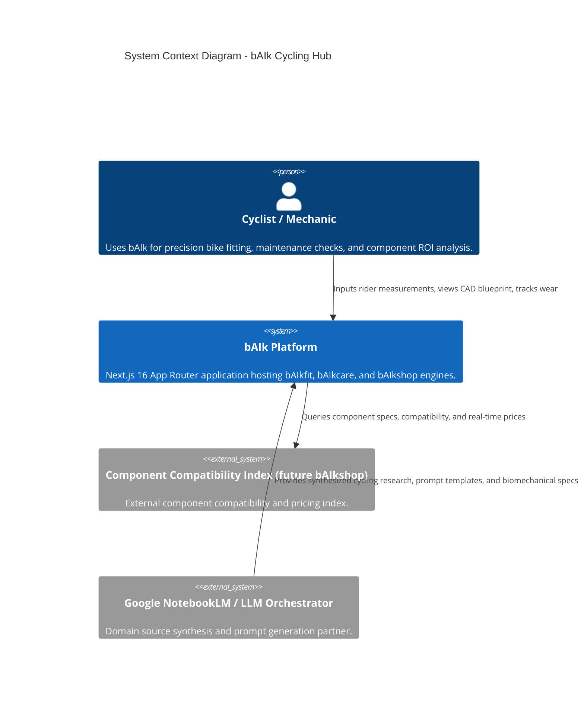
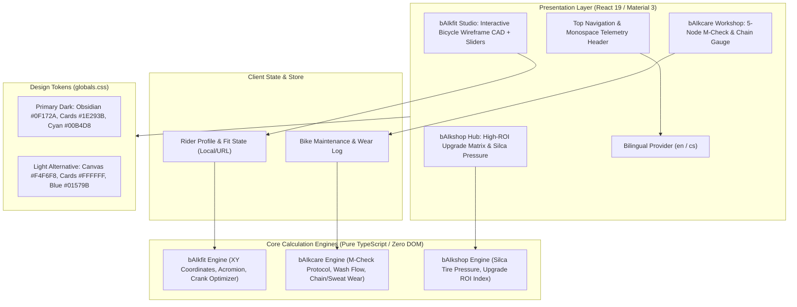
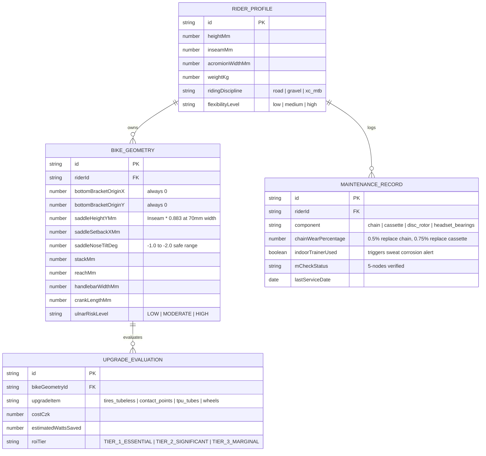

# Architecture Diagrams — bAIk (Universal AI Cycling Intelligence Hub)

**Source**: `docs/architecture/design/00-system-architecture-greenfield.md`  
**Generated**: 2026-10-20  
**Author**: AIRE_ARCHITECT  

> This file contains Mermaid diagrams extracted from the architecture document for easy visual preview.  
> For full architecture details, refer to the source document at [00-system-architecture-greenfield.md](file:///Users/jan.mynar/Documents/GitHub/baik/docs/architecture/design/00-system-architecture-greenfield.md).

---

## 1. System Context Diagram

---

## 2. Component Architecture Diagram

---

## 3. Data Model & ER Diagram

