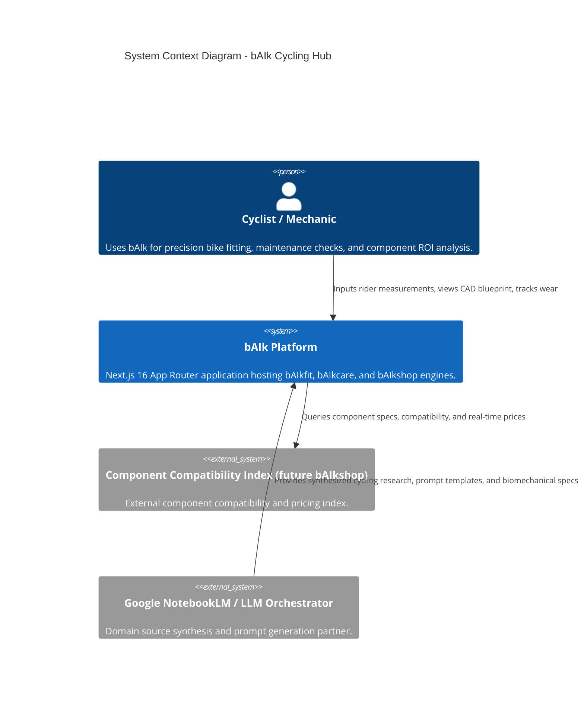
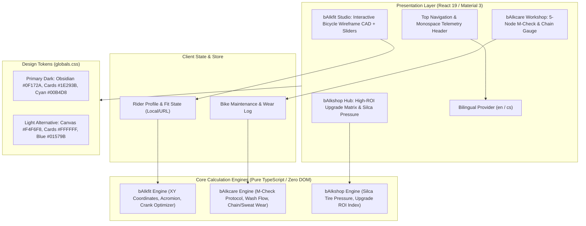
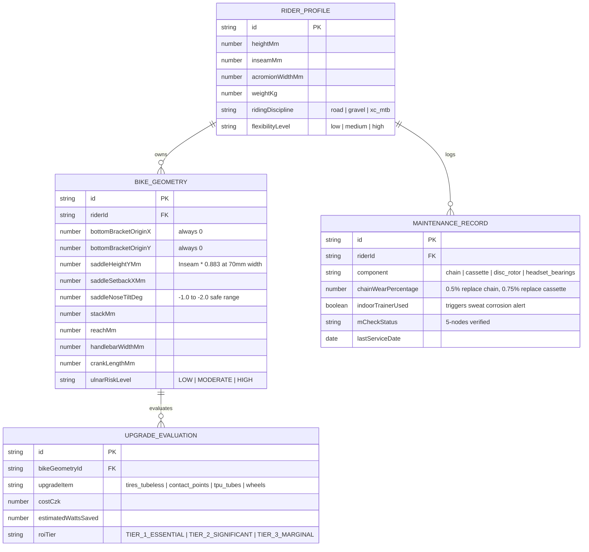

# System Architecture — bAIk (Universal AI Cycling Intelligence Hub)

**Date**: 2026-10-20  
**Author**: AIRE_ARCHITECT  
**Status**: Approved  
**Version**: 1.0  
**Standard**: 3Pillar AIRE SDLC Agentic Framework & CodeGuard Standards

---

## 1. Overview

### 1.1 Purpose
**bAIk** (and the bAIktime Hub) is an intelligent, high-performance cycling platform providing democratized, scientific biomechanical bike fitting (`bAIkfit Engine`), guided workshop maintenance protocols with wear tracking (`bAIkcare Engine`), and objective, high-ROI component upgrade analytics (`bAIkshop Engine`).

### 1.2 Architecture Style
**Modular Next.js 16 (App Router) + Pure Functional Calculation Engines + Design Tokenized Presentation Layer**.
- **Client-Side Reactive CAD & Telemetry**: Instant recalculation with 0ms network latency for biomechanical sliders and vector projections.
- **Pure Core Logic Engines**: Zero DOM dependencies in `src/lib/engines/*`, enabling 100% test coverage and multi-platform portability (Web, Mobile, Node API).
- **Design System Tokens**: CSS Custom Properties (`--bg-canvas`, `--surface-card`, `--accent-cyan`, etc.) delivering **Variant B: High-Contrast Tech Obsidian & Electric Cyan** as primary default, with instant support for Light Mode (Variant A).

### 1.3 Key Architectural Drivers
1. **Mathematical Precision & Biomechanical Integrity**:
   - Universal Cartesian XY Coordinate system with $(0,0)$ datum at the Bottom Bracket.
   - Reference saddle height measured strictly at the 70 mm width section ($Y_{\text{Saddle}} = \text{Inseam} \times 0.883$).
   - Acromion-to-handlebar matching to eliminate ulnar nerve compression (handlebar numbness) and dynamic Nerve Flossing protocols.
2. **Strict UI Constraints (AGENTS.md Compliance)**:
   - **ZERO EMOJIS & ZERO ICONS/AVATARS**: Ultra-clean, serious engineering and medical laboratory aesthetic.
   - Monospace data chips (`[STATUS: CALIBRATED]`, `[MODE: CAD]`), clean tracking, Google Material Design 3 elevation tokens.
3. **Bilingual Parity**:
   - 100% functional parity between English (`en`) and Czech (`cs`).

---

## 2. Technology Stack & Decision Evaluation

| Category | Technology | Version | Justification | Alternatives Considered |
|---|---|---|---|---|
| **Framework** | Next.js (App Router + Turbopack) | 16.x | High-speed server rendering, React 19 Server Components, zero-bundle engine export | Vite + SPA (lacks SSR/SEO), Remix (less ecosystem support) |
| **Language** | TypeScript | 5.8+ | Strict type safety across mathematical models, XY coordinates, and engine contracts | Plain JavaScript (unacceptable runtime risk in geometry calc) |
| **Styling** | Google Material Design 3 / Tailwind CSS + CSS Tokens | 4.x | Tokenized CSS variables (`var(--...)`) allowing seamless Dark/Light switching with zero component rewrites | Material UI / MUI (heavy runtime JS bundle, slower than CSS variables) |
| **Unit Testing** | Vitest + React Testing Library | 3.x | Native ESM, instant feedback loop, high-speed execution, strict TDD workflow | Jest (slower, complex ESM mocking) |
| **State Management** | React Context + URL SearchParams + LocalStorage | React 19 | Lightweight, persistent across sessions, zero third-party state bloat | Redux Toolkit (unnecessary overhead for local fit telemetry) |
| **Localization** | Type-safe JSON Registry (`src/lib/i18n`) | Custom | Zero runtime bundle overhead, 100% type-checked keys for EN and CS | `next-intl` (external dependency overhead not needed for current scope) |

---

## 3. System Context



---

## 4. Component Architecture



---

## 5. Data Model & Contracts



---

## 6. Calculation Engine Interfaces & Contracts

### 6.1 `bAIkfit Engine`
```typescript
export interface RiderMeasurements {
  inseamMm: number;
  acromionWidthMm: number;
  heightMm: number;
  weightKg: number;
  discipline: 'road' | 'gravel' | 'xc_mtb';
}

export interface FitCalculationResult {
  saddleHeightYMm: number; // Inseam * 0.883
  saddleSetbackXMm: number;
  recommendedHandlebarWidthMm: number; // matches acromion width
  recommendedCrankLengthMm: number; // 150-165mm for hip impingement / tall & heavy riders
  recommendedPedalWashersMm: number; // 2-4mm if stance / IT band overload
  stackTargetMm: number;
  reachTargetMm: number;
  ulnarNeuropathyRisk: 'LOW' | 'MODERATE' | 'HIGH';
  nerveFlossingProtocolRequired: boolean;
  warnings: string[];
}
```

### 6.2 `bAIkcare Engine`
```typescript
export interface MCheckNode {
  id: 1 | 2 | 3 | 4 | 5;
  name: string;
  focusArea: string; // e.g. "Front Hub & Skewer", "Headset & Cockpit", "Bottom Bracket & Cranks"
  steps: string[];
  safetyCheck: string;
  passed: boolean;
}

export interface ChainWearEvaluation {
  elongationPercentage: number;
  actionRequired: 'NONE' | 'REPLACE_CHAIN' | 'REPLACE_CHAIN_AND_CASSETTE';
  warningMessage: string;
}

export interface SweatCorrosionCheck {
  indoorTrainerUse: boolean;
  monthsSinceTapeRemoval: number;
  alert: 'SAFE' | 'INSPECT_ALUMINUM_HANDLEBAR';
}
```

---

## 7. Security Design (CodeGuard & OWASP Compliance)

1. **Client-Side Data Isolation**: All biometric inputs and fit geometry calculations are computed strictly in-memory or stored in sanitized browser LocalStorage. No unauthenticated third-party transmission of personal biometric data.
2. **Cryptographic Standards (`codeguard-1-crypto-algorithms`)**: No deprecated ciphers, hashing, or broken algorithms. Any tokenization or hashing uses SHA-256 via modern Web Crypto API (`crypto.subtle`).
3. **No Hardcoded Credentials (`codeguard-1-hardcoded-credentials`)**: Zero API keys or secrets in source code. Any future external integrations utilize environment variables (`process.env.NEXT_PUBLIC_*`).
4. **Input Validation**: Strict schema validation using TypeScript guards ensuring numerical bounds (e.g., Inseam: 500–1200 mm; Acromion: 300–550 mm; Crank: 150–180 mm).

---

## 8. Architectural Decision Records (ADRs)

### ADR-01: Dark Mode Variant B (Obsidian & Electric Cyan) as Primary Default with Tokenized CSS Architecture
- **Context**: The user reviewed 3 Google Material Design 3 palettes and chose Variant B (Tech Obsidian & Electric Cyan) for its high-tech CAD aesthetic, while requesting light mode capability.
- **Decision**: Define CSS variables in `src/app/globals.css` with dark mode values as `:root` default, and map all components to CSS variables (e.g., `var(--bg-canvas)`, `var(--surface-card)`, `var(--accent-cyan)`). Light mode tokens (Variant A) are defined under `[data-theme="light"]`.
- **Consequences**: Instant engineering WOW effect, zero technical debt, zero code duplication when toggling themes.

### ADR-02: Strict Separation of Mathematical Engines from UI Components
- **Context**: Biomechanical calculations must be verifiable with 100% test coverage and reusable across multiple screens.
- **Decision**: Implement all formulas in `src/lib/engines/` as pure, stateless TypeScript functions.
- **Consequences**: Ultra-fast Vitest unit test execution, deterministic results, isolated testing without React rendering overhead.

### ADR-03: Zero Icons & Zero Emojis Mandatory Standard
- **Context**: Product standard requires a serious, professional Google Material Design 3 application without decorative clutter or cartoon icons.
- **Decision**: Reject all decorative icon libraries and emojis. Rely exclusively on bold typography hierarchy, clean tracking, and monospace metadata badges (`[STATUS: READY]`, `[MODE: CAD]`).
