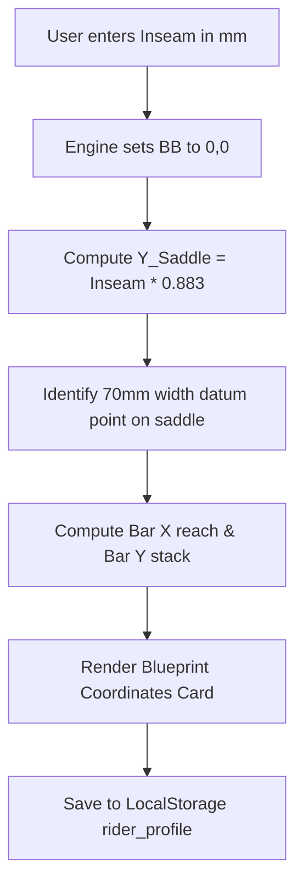

# Story 1.1: bAIkfit — XY Coordinate System & Data Model

**Epic**: 1 (bAIkfit Engine — Smart Bike Fit & Ergonomics)  
**Story ID**: 1.1  
**BUILDID**: CYCLE-1  
**Jira**: LOCAL  
**Author**: ANALYST_PM_GREENFIELD  
**Status**: Ready for Dev  

---

## User Flow & Journey

**User Journey**:
1. **Entry**: Cyclist navigates to the `bAIkfit` section of bAIktime Hub.
2. **Input**: Cyclist enters Inseam height (mm), current saddle setback (mm), and stem reach/stack (mm).
3. **Calculation**: The engine establishes the Bottom Bracket Center as Datum Point $(0,0)$. It calculates target Saddle Height ($Y = \text{Inseam} \times 0.883$) and defines the measurement position at the exact 70mm saddle width mark.
4. **Output**: Interactive blueprint card displays $X_{\text{Saddle}}$, $Y_{\text{Saddle}}$, $X_{\text{Bar}}$, $Y_{\text{Bar}}$ coordinates with clear millimeter tolerance guides.
5. **Persistence**: Values are stored in `baiktime_rider_profile` in LocalStorage for cross-module consumption in `bAIkcare` and `bAIkshop`.



---

## 🤖 AI Agent Reference

**Target Stack**: TypeScript, React 19, Google Material Design 3.  
**Style Rules**: Pure White Cards (`#ffffff`), Soft Neutral Canvas (`#f4f6f8`), Material Blue (`#01579b`), Deep Slate text (`#263238`). **Zero icons and zero emojis.**

### Acceptance Criteria
- [ ] **AC 1.1.1 (Datum Point Origin):** Origin point $(0,0)$ is explicitly defined as the Center of the Bottom Bracket Shell.
- [ ] **AC 1.1.2 (LeMond Formula):** $Y_{\text{Saddle}}$ calculates as $\text{Inseam (mm)} \times 0.883 \pm 1\text{mm}$.
- [ ] **AC 1.1.3 (70mm Datum Specification):** UI and metadata explicitly instruct user to measure $X$ and $Y$ coordinates from the BB to the point on the saddle where the top surface width is exactly 70mm.
- [ ] **AC 1.1.4 (Input Validation):** Inseam accepts numbers between 500mm and 1100mm; out-of-range values display inline Material error chip without crashing.
- [ ] **AC 1.1.5 (Persistence):** Successfully writes `{ datum: [0,0], saddle: { x, y }, bar: { x, y } }` to `localStorage`.

### Out of Scope ❌
- Optical automated webcam detection of saddle coordinates.
- Multi-bike cloud syncing (Guest LocalStorage only in this story).

### Localization Schema (EN / CZ)
```typescript
export const xyCalculatorTranslations = {
  en: {
    title: 'Universal XY Coordinate Fit',
    datumTitle: 'Datum Point: Bottom Bracket (0,0)',
    inseamLabel: 'Inseam Height (mm)',
    saddleHeight: 'Calculated Saddle Height (Y)',
    saddle70mmNote: 'Measure from BB center to the 70mm width mark on the saddle.',
    barReach: 'Cockpit Reach (X)',
    barStack: 'Cockpit Stack (Y)',
    saveButton: 'Save Coordinates to Profile',
  },
  cs: {
    title: 'Univerzální XY Souřadnicový Posed',
    datumTitle: 'Vztažný bod: Středové složení (0,0)',
    inseamLabel: 'Vnitřní délka nohy (mm)',
    saddleHeight: 'Vypočtená výška sedla (Y)',
    saddle70mmNote: 'Měřeno od středu BB k bodu o šířce 70 mm na skořepině sedla.',
    barReach: 'Dosah kokpitu Reach (X)',
    barStack: 'Výška kokpitu Stack (Y)',
    saveButton: 'Uložit souřadnice do profilu',
  },
};
```
