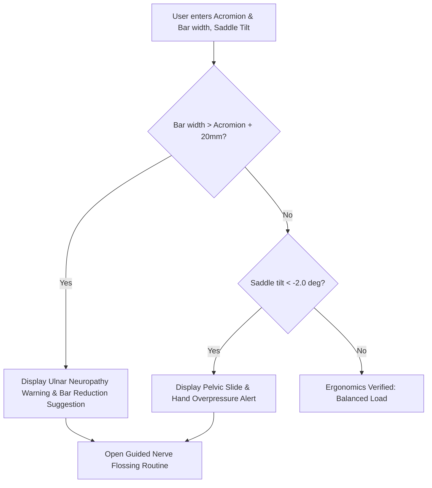

# Story 1.2: bAIkfit — Acromion Shoulder Width, Numb Hands Diagnostic & Nerve Flossing

**Epic**: 1 (bAIkfit Engine — Smart Bike Fit & Ergonomics)  
**Story ID**: 1.2  
**BUILDID**: CYCLE-1  
**Jira**: LOCAL  
**Author**: ANALYST_PM_GREENFIELD  
**Status**: Ready for Dev  

---

## User Flow & Journey

**User Journey**:
1. **Entry**: Cyclist with hand numbness or neck/shoulder ache opens the Cockpit Ergonomics diagnostic.
2. **Measurement Input**: Enters Acromion shoulder width (mm), current handlebar width (mm), and saddle downward tilt (degrees).
3. **Risk Analysis**:
   - If Handlebar Width > Acromion Width + 20mm: The engine raises an Ulnar Nerve Compression alert (wrist rolling inwards, flared elbows, trapezius fatigue).
   - If Saddle Tilt < -2.0°: Raises Excessive Downward Pitch alert (anterior pelvic slide, excessive braking force on hands).
4. **Guided Solution**: Presents interactive Nerve Flossing sequence for the ulnar nerve (alternating head tilt with elbow extension/flexion) with zero static stretching.



---

## 🤖 AI Agent Reference

### Acceptance Criteria
- [ ] **AC 1.2.1 (Acromion Rule):** Evaluates $\text{Bar Width} - \text{Acromion Width}$. When delta $> 20\text{mm}$, triggers warning stating risk to ulnar nerve and trapezius overload.
- [ ] **AC 1.2.2 (Saddle Pitch Guardrail):** When saddle pitch is steeper than $-2.0^\circ$ downward, displays warning regarding gravitational slide and hand overpressure.
- [ ] **AC 1.2.3 (Nerve Flossing Step-by-Step Flow):** Renders clean, typography-driven 3-step dynamic glide protocol (head tilted towards working arm during elbow flexion, head tilted away during extension).
- [ ] **AC 1.2.4 (Zero Icons & Emojis):** Warning chips use monospace uppercase status tags (`WARNING: ULNAR NERVE RISK`, `STATUS: OPTIMAL`) without emoji icons.
- [ ] **AC 1.2.5 (Bilingual Coverage):** 100% translation coverage for EN and CS.

### Out of Scope ❌
- Medical prescription or physiotherapy certification claims (informational biomechanics disclaimer included).

### Localization Schema (EN / CZ)
```typescript
export const numbHandsTranslations = {
  en: {
    title: 'Cockpit Diagnostic & Nerve Flossing',
    acromionLabel: 'Acromion Shoulder Width (mm)',
    barWidthLabel: 'Current Handlebar Width (mm)',
    tiltLabel: 'Saddle Pitch (degrees, negative for nose down)',
    ulnarAlert: 'Warning: Handlebars are wider than your shoulder structure. Inward wrist rolling compresses the ulnar nerve and strains trapezius muscles.',
    tiltAlert: 'Warning: Downward saddle pitch exceeds 2 degrees. Pelvis slides forward, forcing hands to bear excessive upper body weight.',
    flossingTitle: 'Ulnar Nerve Flossing Protocol',
    flossingStep1: '1. Raise arm to shoulder level, form circular grip with thumb and index finger.',
    flossingStep2: '2. Flex elbow bringing hand toward face while tilting head TOWARDS the hand (slacking the nerve).',
    flossingStep3: '3. Extend elbow while tilting head AWAY from the hand (gliding the nerve through the sheath). Do not stretch statically.',
  },
  cs: {
    title: 'Diagnostika kokpitu & Mobilizace nervů',
    acromionLabel: 'Šířka ramen přes akromion proces (mm)',
    barWidthLabel: 'Současná šířka řídítek (mm)',
    tiltLabel: 'Sklon sedla (stupně, záporné pro sklon dolů)',
    ulnarAlert: 'Varování: Řídítka jsou širší než vaše ramenní stavba. Vytáčení zápěstí dovnitř utlačuje ulnární nerv a přetěžuje trapézové svaly.',
    tiltAlert: 'Varování: Sklon sedla dolů překračuje 2 stupně. Pánev klouže dopředu a dlaně musí reflexivně nést nepřirozenou zátěž trupu.',
    flossingTitle: 'Protokol mobilizace ulnárního nervu (Nerve Flossing)',
    flossingStep1: '1. Zvedněte ruku do výšky ramen, spojte palec a ukazováček do tvaru brýlí.',
    flossingStep2: '2. Pokrčte loket k obličeji a současně nakloňte hlavu K ruce (uvolnění tahu nervu).',
    flossingStep3: '3. Propínejte paži a současně naklánějte hlavu OD ruky (plynulý posun nervu v pouzdře). Nikdy nenatahujte staticky.',
  },
};
```
