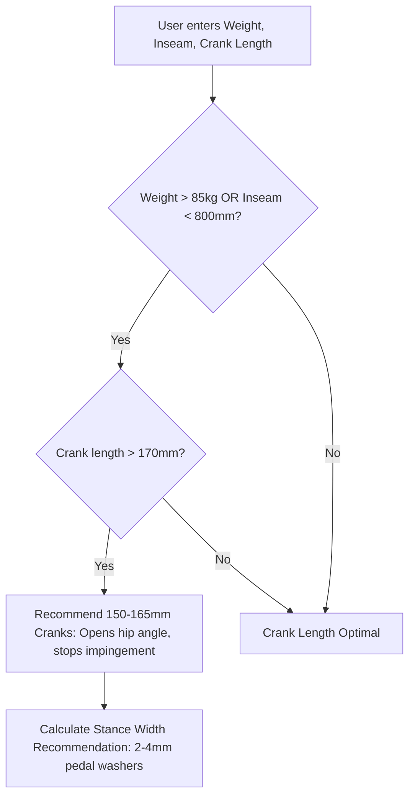

# Story 1.3: bAIkfit — Large & Heavy Rider Crank Shortening & Stance Optimizer

**Epic**: 1 (bAIkfit Engine — Smart Bike Fit & Ergonomics)  
**Story ID**: 1.3  
**BUILDID**: CYCLE-1  
**Jira**: LOCAL  
**Author**: ANALYST_PM_GREENFIELD  
**Status**: Ready for Dev  

---

## User Flow & Journey

**User Journey**:
1. **Entry**: Heavy rider, tall cyclist, or rider with hip impingement / abdomen collision in the drops opens the Specific Biomechanics module.
2. **Parameters**: Enters Rider Weight (kg), Inseam (mm), and current Crank Length (mm).
3. **Calculation**:
   - If Rider Weight $> 85\text{ kg}$ or Inseam $< 800\text{ mm}$ with Cranks $> 170\text{ mm}$: The engine calculates hip closure angle and recommends shorter cranks ($150\text{--}165\text{ mm}$) to open the hip angle and eliminate impingement at top-dead-center.
   - For wider pelvic structures, the engine recommends pedal stance widening via $2\text{--}4\text{ mm}$ pedal washers or wide-axle pedals.
4. **Actionable Output**: Clear recommendation with mechanical rationale (preserving terminal extension while eliminating upper-quad compression).



---

## 🤖 AI Agent Reference

### Acceptance Criteria
- [ ] **AC 1.3.1 (Crank Optimization Trigger):** When Rider Weight $> 85\text{ kg}$ and Crank Length $> 170\text{ mm}$, system outputs recommendation for $155\text{--}165\text{ mm}$ cranks.
- [ ] **AC 1.3.2 (Stance Width Guidance):** Outputs specific mechanical guidance: "Add 2–3mm pedal washers or move cleats inboard on shoe soles".
- [ ] **AC 1.3.3 (Hip Impingement Education):** Displays concise mechanical rationale explaining why shorter cranks open the hip joint at top-dead-center without sacrificing saddle height.
- [ ] **AC 1.3.4 (Strict Material Design):** Clean monospace technical callouts; zero decorative icons.
- [ ] **AC 1.3.5 (EN/CZ Parity):** All guidance completely localized in English and Czech.

### Out of Scope ❌
- Dynamic 3D knee track video tracking (deferred to future computer vision releases).

### Localization Schema (EN / CZ)
```typescript
export const heavyRiderTranslations = {
  en: {
    title: 'Heavy & Tall Rider Biomechanics',
    weightLabel: 'Rider Body Weight (kg)',
    crankLabel: 'Current Crank Length (mm)',
    crankAlert: 'Recommendation: Shorten cranks to 150–165 mm. Shorter cranks open the hip angle at top-dead-center, preventing abdomen collision and lower back rocking.',
    stanceAlert: 'Stance Width Advice: Use 2–3 mm pedal washers or move cleats inward to widen your stance width and align knees with hips.',
  },
  cs: {
    title: 'Biomechanika pro těžší a vyšší jezdce',
    weightLabel: 'Hmotnost jezdce (kg)',
    crankLabel: 'Současná délka klik (mm)',
    crankAlert: 'Doporučení: Zkraťte kliky na 150–165 mm. Kratší kliky otevřou úhel kyčle v horní úvrati šlapání, zabrání kolizi břicha se stehnem a houpání pánve.',
    stanceAlert: 'Úprava šířky postoje: Použijte 2–3 mm podložky pod pedály nebo posuňte kufry k vnitřnímu okraji tretry pro srovnání osy kolen a kyčlí.',
  },
};
```
