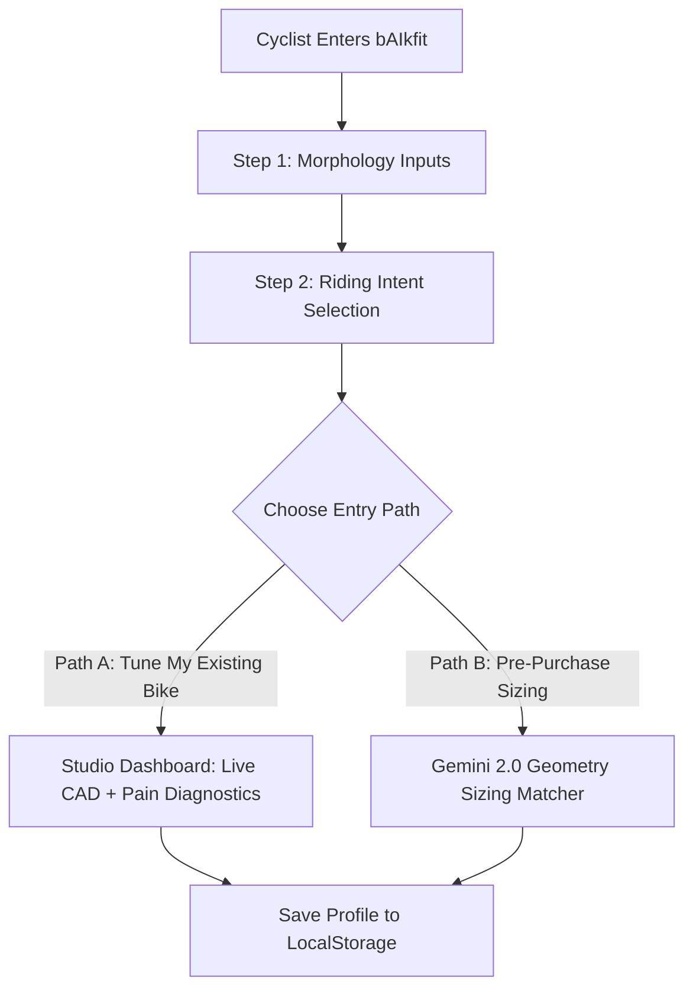

# Story 1.4: bAIkfit — Step-by-Step Onboarding Wizard & Two-Path Entry Flow

**Epic**: 1 (bAIkfit Engine — Smart Bike Fit & Pre-Purchase Geometry Matcher)  
**Story ID**: 1.4  
**BUILDID**: CYCLE-1  
**Jira**: LOCAL  
**Author**: ANALYST_PM_GREENFIELD  
**Status**: Ready for Dev  

---

## 👤 User Reference

### Summary & User Flow
When a cyclist arrives at the bAIkfit platform, they need a structured, non-intimidating way to input their physical measurements and declare their cycling goals before seeing complex technical blueprints.

The wizard provides an intuitive multi-step experience:
1. **Morphology Step**: Inseam (mm), Total Height (mm), Torso length (mm), Arm length (mm), and Acromion Shoulder Width (mm).
2. **Intent Step**: Riding Intent selector between `Comfort / Endurance` (relaxed torso, reduced drop) vs. `Race / Aggressive` (aerodynamic drop, lower stack).
3. **Branching Selector**:
   - **PATH A: "Tune My Existing Bike"**: Directs the user to the interactive studio with acute pain relief diagnostics (hand numbness, saddle tilt, crank impingement).
   - **PATH B: "Pre-Purchase Geometry Sizing Match"**: Directs the user to the Gemini AI bike analysis interface where they can evaluate a bike before buying.



---

## 🤖 AI Agent Reference

**Target Tech Stack**: Next.js 15 (App Router), React 19, TypeScript, Google Material Design 3, Tailwind CSS.  
**Style Guidelines**: Variant B (Obsidian `#0f172a`, Cards `#1e293b`, Electric Cyan `#00b4d8`, Neon Teal `#14b8a6`).  
**Design Constraint**: **ZERO ICONS & ZERO EMOJIS**. Typography-driven hierarchy only, with monospace telemetry chips (`mono-chip`).

### Acceptance Criteria

- [ ] **AC 1.4.1 (Morphology Input Validation):**
  - Height accepts values between $1300\text{ mm}$ and $2200\text{ mm}$.
  - Inseam accepts values between $500\text{ mm}$ and $1100\text{ mm}$.
  - Torso length accepts values between $450\text{ mm}$ and $800\text{ mm}$.
  - Arm length accepts values between $450\text{ mm}$ and $900\text{ mm}$.
  - Acromion shoulder width accepts values between $300\text{ mm}$ and $520\text{ mm}$.
  - Values outside these bounds trigger inline monospace error chips without form submit.
- [ ] **AC 1.4.2 (Intent Back Angle Calibration):**
  - Selecting `Comfort/Endurance` sets target back angle baseline to $65\text{--}80^\circ$ (higher stack, shorter reach).
  - Selecting `Race/Aggressive` sets target back angle baseline to $45\text{--}55^\circ$ (lower stack, extended reach).
- [ ] **AC 1.4.3 (Two-Path Navigation):**
  - Clicking `Tune My Existing Bike` routes directly to the main CAD Studio (`/studio`) with pre-calculated coordinates.
  - Clicking `Pre-Purchase Geometry Sizing Match` opens the Gemini URL/Model input module (`/studio/pre-purchase`).
- [ ] **AC 1.4.4 (Progress Persistence & Re-entry):**
  - Wizard state automatically caches to `localStorage.setItem('baikfit_onboarding', ...)` on each step change so riders do not lose input upon accidental refresh.
  - Users can reopen the wizard at any time via an "Edit Morphology" button in the header.
- [ ] **AC 1.4.5 (100% Bilingual Parity):**
  - Every step title, input label, helper description, and navigation button is 100% localized in English (`en`) and Czech (`cs`).

### Out of Scope ❌
- Webcam / LiDAR body scanning (deferred to Cycle 2).
- Mandatory user registration / email gating prior to completing wizard.

### Localization Schema (EN / CS)

```typescript
export const onboardingTranslations = {
  en: {
    wizardTitle: 'Rider Biomechanical Onboarding',
    step1Title: 'Morphology Measurements',
    step2Title: 'Riding Intent & Posture',
    step3Title: 'Choose Your Journey',
    heightLabel: 'Total Rider Height (mm)',
    inseamLabel: 'Inseam / Crotch Height (mm)',
    torsoLabel: 'Torso Length (mm)',
    armLabel: 'Arm Reach Length (mm)',
    acromionLabel: 'Acromion Shoulder Width (mm)',
    intentComfort: 'Comfort & Endurance',
    intentComfortDesc: 'Relaxed back angle (65-80°), reduced spinal compression, long-distance touring.',
    intentRace: 'Race & Aerodynamic',
    intentRaceDesc: 'Aggressive torso angle (45-55°), lower stack, maximized aerodynamic efficiency.',
    pathATitle: 'Tune My Existing Bike',
    pathASubtitle: 'Diagnose hand numbness, saddle pain, and optimize your current geometry.',
    pathBTitle: 'Pre-Purchase Sizing Match',
    pathBSubtitle: 'Analyze a prospective bike URL/model via Gemini AI before buying.',
    nextStep: 'Continue',
    prevStep: 'Back',
  },
  cs: {
    wizardTitle: 'Biomechanický Vstupní Průvodce Jezdce',
    step1Title: 'Tělesné Rozměry',
    step2Title: 'Jízdní Styl & Pozice',
    step3Title: 'Zvolte Typ Analýzy',
    heightLabel: 'Celková výška jezdce (mm)',
    inseamLabel: 'Vnitřní délka nohou (mm)',
    torsoLabel: 'Délka trupu (mm)',
    armLabel: 'Délka paže (mm)',
    acromionLabel: 'Šířka ramen v nadpažcích (mm)',
    intentComfort: 'Komfort & Vytrvalost',
    intentComfortDesc: 'Vzpřímenější úhel zad (65-80°), menší tlak na krční páteř, celodenní jízdy.',
    intentRace: 'Závodní & Aerodynamický',
    intentRaceDesc: 'Agresivní sklon trupu (45-55°), nižší hlavová trubka, maximální aero efektivita.',
    pathATitle: 'Nastavit Moje Stávající Kolo',
    pathASubtitle: 'Odstranit brnění rukou, bolesti sedacích partií a vyladit posed na aktuálním kole.',
    pathBTitle: 'Ověřit Velikost Před Koupí',
    pathBSubtitle: 'Analyzovat geometrii vyhlédnutého kola z odkazu/modelu pomocí Gemini AI před nákupem.',
    nextStep: 'Pokračovat',
    prevStep: 'Zpět',
  },
};
```
