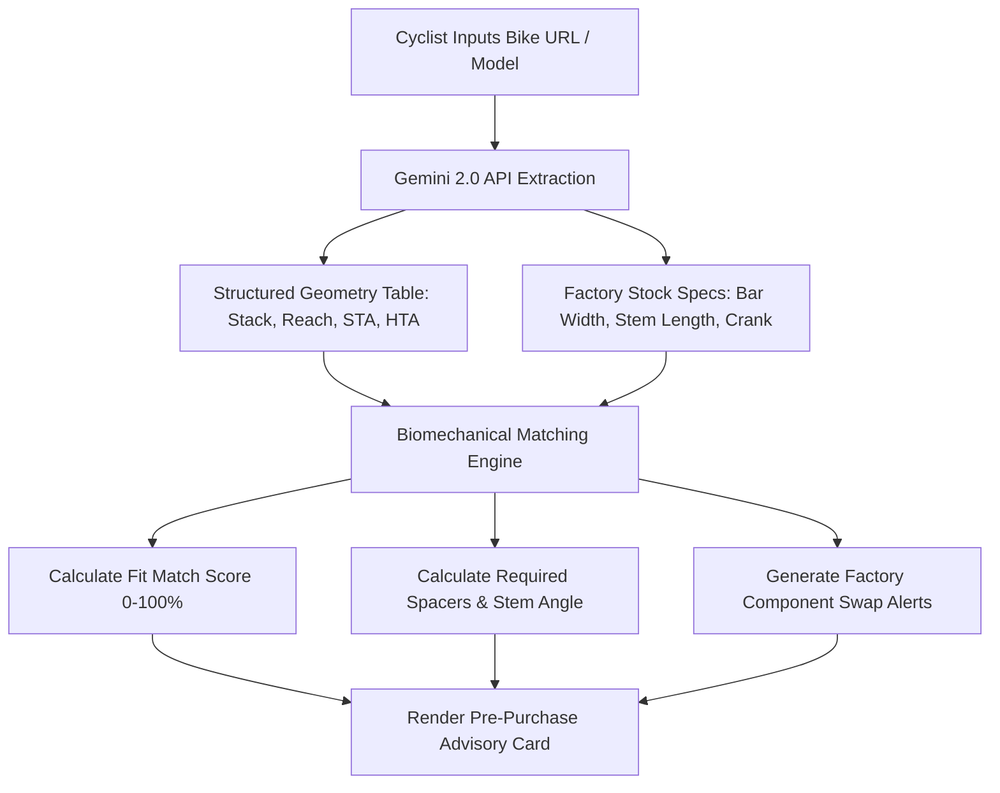

# Story 1.5: bAIkfit — Gemini 2.0 API Pre-Purchase Geometry Sizing Matcher

**Epic**: 1 (bAIkfit Engine — Smart Bike Fit & Pre-Purchase Geometry Matcher)  
**Story ID**: 1.5  
**BUILDID**: CYCLE-1  
**Jira**: LOCAL  
**Author**: ANALYST_PM_GREENFIELD  
**Status**: Ready for Dev  

---

## 👤 User Reference

### Summary & User Flow
Before buying a bike online or in a shop, cyclists often struggle to interpret complex geometry charts (Stack, Reach, Effective Top Tube, Seat Tube Angle) and frequently purchase the wrong size or receive mismatched stock components (such as 42cm handlebars for a rider with 38cm shoulders, or 172.5mm cranks for an 80kg rider with short inseam).

In this flow:
1. Cyclist pastes an e-commerce URL (Canyon, Trek, Specialized, Rose, etc.) or types the bike model name (e.g., *"Canyon Endurace CF 7 Size L"*).
2. The Gemini 2.0 API automatically parses the product page or knowledge base, extracting the geometry table and factory component specs into structured JSON.
3. The engine cross-references the bike's geometry with the rider's morphology and calculated target coordinates.
4. The user receives:
   - **Fit Match Score (0–100%)**: Indicates how comfortably the rider's target stack and reach can be achieved.
   - **Recommended Frame Size**: e.g., *"Size M is optimal (94% match); Size L is too long in reach (+24mm)"*.
   - **Spacer & Stem Guide**: Exact millimeter spacer stack required under the stem (e.g., *"20mm spacers with stock -6° stem"*).
   - **Factory Component Swap Alerts**: Actionable guidance before delivery (e.g., *"Stock 420mm handlebar exceeds your 380mm shoulder width; request shop swap to 380mm to avoid ulnar nerve pinching"*).



---

## 🤖 AI Agent Reference

**Target Tech Stack**: Next.js 15 (App Router Route Handlers), React 19, TypeScript, Google Gemini 2.0 API (`@google/genai` or standard REST endpoint), Google Material Design 3.  
**Security & CodeGuard Compliance**:
- **No Hardcoded Credentials**: API key stored strictly in `process.env.GEMINI_API_KEY` (or BYOK in LocalStorage for client-side evaluation).
- **Safe Outbound URLs**: Validate URLs with strict URL parsing; block internal/localhost/private network IPs (SSRF prevention).
- **Zero Icons & Zero Emojis**: Monospace badges and clean typography only.

### Structured Gemini Extraction Schema

```json
{
  "brand": "Canyon",
  "model": "Endurace CF 7",
  "size": "M",
  "stack_mm": 568,
  "reach_mm": 378,
  "effective_top_tube_mm": 553,
  "seat_tube_angle_deg": 73.5,
  "head_tube_angle_deg": 72.8,
  "stock_specs": {
    "bar_width_mm": 420,
    "stem_length_mm": 100,
    "crank_length_mm": 172.5
  }
}
```

### Acceptance Criteria

- [ ] **AC 1.5.1 (Input & SSRF Sanitization):**
  - Accepts standard HTTP/HTTPS URLs or freeform text queries (e.g., *"Trek Domane SL 6 Gen 4 Size 56"*).
  - Validates protocols (only `http:` and `https:`); blocks `file:`, `localhost`, and internal IP addresses per CodeGuard SSRF rules.
- [ ] **AC 1.5.2 (Gemini 2.0 Structured Parsing):**
  - Invokes Gemini 2.0 API using JSON Mode (`responseSchema`) to extract frame geometry and stock components deterministically.
  - Handles parsing errors gracefully with clear user-facing error text if a page has no recognizable geometry table.
- [ ] **AC 1.5.3 (Fit Match Score Calculation):**
  - Compares rider's target Cockpit Stack & Reach against frame Stack & Reach.
  - Computes Fit Match Score ($0\text{--}100\%$):
    - Score $\ge 90\%$: Excellent Fit (achievable within $\le 20\text{mm}$ standard spacers).
    - Score $70\text{--}89\%$: Acceptable Fit with stem adjustment ($+10\text{mm}$ or $-10\text{mm}$ stem swap).
    - Score $< 70\%$: Mismatched Size (frame too long, too short, or requires extreme spacer towers $> 40\text{mm}$).
- [ ] **AC 1.5.4 (Factory Component Swap Warnings):**
  - If stock bar width $> \text{acromion width} + 15\text{mm}$: Generates explicit pre-purchase swap advisory.
  - If rider weight $> 85\text{kg}$ or inseam $< 800\text{mm}$ and stock cranks $> 170\text{mm}$: Generates crank shortening recommendation.
- [ ] **AC 1.5.5 (Bilingual Parity EN / CS):**
  - All match results, score badges, spacer instructions, and component swap warnings support 100% parity across English and Czech.

### Out of Scope ❌
- Direct automated shopping cart checkout on third-party retailer websites.
- Live automated stock inventory checking across local bike shops.

### Localization Schema (EN / CS)

```typescript
export const prePurchaseTranslations = {
  en: {
    title: 'Pre-Purchase Geometry Sizing Matcher',
    subtitle: 'Evaluate bike geometry and factory components before buying online.',
    inputPlaceholder: 'Paste e-commerce URL or enter bike model & size...',
    analyzeButton: 'Analyze via Gemini AI',
    analyzingText: 'Extracting geometry tables & factory specs...',
    fitScoreLabel: 'Biomechanical Fit Match Score',
    recommendedSize: 'Recommended Frame Size',
    spacersRequired: 'Spacers Under Stem Required',
    stemAdjustment: 'Stem Recommendation',
    componentAlertHeader: 'Factory Component Swap Advisories',
    swapBarAlert: 'Stock {stock}mm handlebar exceeds your {acromion}mm shoulder width. Request swap to {recommended}mm before delivery to prevent ulnar neuropathy.',
    swapCrankAlert: 'Stock {stock}mm crank may cause hip impingement. Consider requesting {recommended}mm cranks.',
  },
  cs: {
    title: 'Ověření Velikosti a Geometrie Před Nákupem',
    subtitle: 'Posouzení geometrie rámu a sériových komponent před koupí v e-shopu.',
    inputPlaceholder: 'Vložte odkaz na e-shop nebo název modelu kola a velikost...',
    analyzeButton: 'Analyzovat pomocí Gemini AI',
    analyzingText: 'Extrahuji tabulku geometrie a sériové osazení...',
    fitScoreLabel: 'Skóre Biomechanické Shody Rámu',
    recommendedSize: 'Doporučená Velikost Rámu',
    spacersRequired: 'Požadované Podložky pod Představec',
    stemAdjustment: 'Doporučení k Představci',
    componentAlertHeader: 'Doporučení k Výměně Sériových Komponent',
    swapBarAlert: 'Sériová řídítka {stock} mm jsou příliš široká pro vaše ramena ({acromion} mm). Požádejte prodejce před montáží o výměnu za {recommended} mm, předejdete brnění rukou.',
    swapCrankAlert: 'Sériové kliky {stock} mm mohou způsobovat sevření kyčle v horní úvrati. Doporučujeme požadovat kliky {recommended} mm.',
  },
};
```
