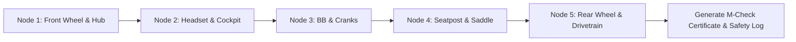

# Story 2.1: bAIkcare — Guided M-Check Inspection Protocol

**Epic**: 2 (bAIkcare Engine — DIY Maintenance & Service)  
**Story ID**: 2.1  
**BUILDID**: CYCLE-1  
**Jira**: LOCAL  
**Author**: ANALYST_PM_GREENFIELD  
**Status**: Ready for Dev  

---

## User Flow & Journey

**User Journey**:
1. **Entry**: Cyclist wanting to verify bike safety before a weekend ride opens the `bAIkcare M-Check` protocol.
2. **Interactive Flow**: Progresses through the 5 physical nodes mapped along the capital letter 'M':
   - **Node 1 (Front Wheel):** Checks tire sidewall cuts, axle torque, hub play, and rotor trueness.
   - **Node 2 (Headset & Cockpit):** Performs rock-and-brake test for headset play, verifies stem clamp bolts.
   - **Node 3 (Bottom Bracket & Cranks):** Checks bearing smoothness without chain, tests pedal tightness (left pedal reverse thread reminder).
   - **Node 4 (Seatpost & Saddle):** Verifies minimum insertion mark, clamp torque, and saddle rail lubrication.
   - **Node 5 (Rear Wheel & Drivetrain):** Checks derailleur hanger alignment, chain wear, and cassette play.
3. **Completion**: Generates a certified status summary (`PASS` / `NEEDS ATTENTION`) and saves inspection timestamp to LocalStorage.



---

## 🤖 AI Agent Reference

### Acceptance Criteria
- [ ] **AC 2.1.1 (5 Sequential Nodes):** Exactly 5 nodes matching the 'M' path are presented in linear, step-by-step order.
- [ ] **AC 2.1.2 (Pass / Attention Toggles):** Each node has explicit check items that can be toggled `OK` or `Issue Detected`.
- [ ] **AC 2.1.3 (LH Thread Reminder):** Node 3 includes an explicit warning banner: "Left-side pedal uses reverse (left-hand) thread".
- [ ] **AC 2.1.4 (Summary & Persistence):** On completion, overall inspection state is compiled and saved to `baiktime_mcheck_history`.
- [ ] **AC 2.1.5 (Design Constraints):** Zero emojis or decorative icon boxes. Clean progress indicator (`Step 1 of 5`).
- [ ] **AC 2.1.6 (Localization):** Complete EN and CZ translations for all 5 inspection nodes and safety warnings.

### Out of Scope ❌
- Audio acoustic frequency vibration analysis of bearings (future sensor integration).

### Localization Schema (EN / CZ)
```typescript
export const mCheckTranslations = {
  en: {
    title: 'Guided M-Check Safety Inspection',
    node1: 'Node 1: Front Wheel, Hub & Brake Rotor',
    node2: 'Node 2: Headset Preload & Cockpit Clamp',
    node3: 'Node 3: Bottom Bracket, Chainrings & Pedals',
    node4: 'Node 4: Seatpost Insertion & Saddle Rails',
    node5: 'Node 5: Rear Wheel, Cassette & Derailleur',
    passStatus: 'Inspection Status: Road Ready',
    attentionStatus: 'Inspection Status: Maintenance Required',
    leftThreadWarn: 'Important: The left pedal is reverse threaded (turn clockwise to loosen).',
  },
  cs: {
    title: 'Průvodce inspekcí M-Check',
    node1: 'Uzel 1: Přední kolo, náboj a brzdový kotouč',
    node2: 'Uzel 2: Hlavové složení a šrouby představce',
    node3: 'Uzel 3: Středové složení, převodníky a pedály',
    node4: 'Uzel 4: Zásun sedlovky a ližiny sedla',
    node5: 'Uzel 5: Zadní kolo, kazeta a přehazovačka',
    passStatus: 'Stav inspekce: Kolo je připraveno k jízdě',
    attentionStatus: 'Stav inspekce: Vyžadován servisní zásah',
    leftThreadWarn: 'Důležité: Levý pedál má opačný (levotočivý) závit (povoluje se po směru hodinových ručiček).',
  },
};
```
