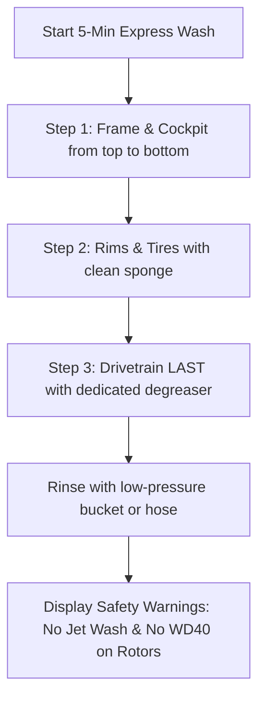

# Story 2.2: bAIkcare — Express 5-Minute Wash Flow & Safety Protocol

**Epic**: 2 (bAIkcare Engine — DIY Maintenance & Service)  
**Story ID**: 2.2  
**BUILDID**: CYCLE-1  
**Jira**: LOCAL  
**Author**: ANALYST_PM_GREENFIELD  
**Status**: Ready for Dev  

---

## User Flow & Journey

**User Journey**:
1. **Entry**: Cyclist wanting to clean bike quickly after a muddy or dusty ride opens the Wash Guide.
2. **Sequential Flow**:
   - **Step 1:** Frame & Cockpit (soft brush, car shampoo, top to bottom).
   - **Step 2:** Wheels & Rims (separate clean sponge).
   - **Step 3 (ABSOLUTE LAST):** Drivetrain (dedicated chain degreaser to prevent spreading black grease onto brake tracks and frame paint).
3. **Safety Warnings Display**: Emphasizes two critical bans:
   - BAN direct high-pressure jet washing onto cartridge bearings (headset, bottom bracket, wheel hubs).
   - BAN WD-40, GT85, or petroleum aerosol sprays on disc brake rotors (isopropyl alcohol only).



---

## 🤖 AI Agent Reference

### Acceptance Criteria
- [ ] **AC 2.2.1 (Strict 3-Step Sequence):** Step 1 (Frame/Cockpit) -> Step 2 (Wheels) -> Step 3 (Drivetrain LAST).
- [ ] **AC 2.2.2 (Bearing Jet Wash Ban):** Displays prominent Material alert chip prohibiting high-pressure washers on pivot and bottom bracket bearings.
- [ ] **AC 2.2.3 (Disc Rotor Protection):** Displays prominent Material alert prohibiting aerosol penetrating oils (WD-40/GT85) on disc rotors, specifying 99% Isopropyl Alcohol as the only allowed solvent.
- [ ] **AC 2.2.4 (Material Aesthetics):** Neutral canvas, white card, zero icons/emojis.
- [ ] **AC 2.2.5 (Localization):** Complete EN and CZ versions.

### Out of Scope ❌
- Ultrasonic chain cleaning hot wax crockpot automation timers.

### Localization Schema (EN / CZ)
```typescript
export const washProtocolTranslations = {
  en: {
    title: 'Express 5-Minute Cleaning Protocol',
    step1: 'Step 1: Frame and Cockpit (wash top to bottom with soapy water).',
    step2: 'Step 2: Wheels and Tires (use a separate clean sponge).',
    step3: 'Step 3: Drivetrain (wash chain and cassette LAST to prevent spreading grease).',
    jetWashAlert: 'Safety Rule: Never use a high-pressure jet wash directly on headset, bottom bracket, or wheel hub bearings.',
    wd40Alert: 'Safety Rule: Never spray WD-40 or aerosol oils near brake rotors or pads. Use 99% isopropyl alcohol only.',
  },
  cs: {
    title: 'Express 5-minutový mycí protokol',
    step1: 'Krok 1: Rám a kokpit (omyjte shora dolů mýdlovou vodou).',
    step2: 'Krok 2: Kola a pláště (použijte samostatnou čistou houbu).',
    step3: 'Krok 3: Pohon (řetěz a kazetu čistěte AŽ NAKONEC, aby se černá mastnota neroznesla na rám a brzdy).',
    jetWashAlert: 'Bezpečnostní pravidlo: Nikdy nestříkejte tlakovou myčkou (wapkou) přímo do ložisek hlavového složení, středu a nábojů.',
    wd40Alert: 'Bezpečnostní pravidlo: Zákaz aplikace WD-40 a penetračních sprejů v blízkosti kotoučů a brzdových destiček. Používejte výhradně 99% isopropylalkohol.',
  },
};
```
