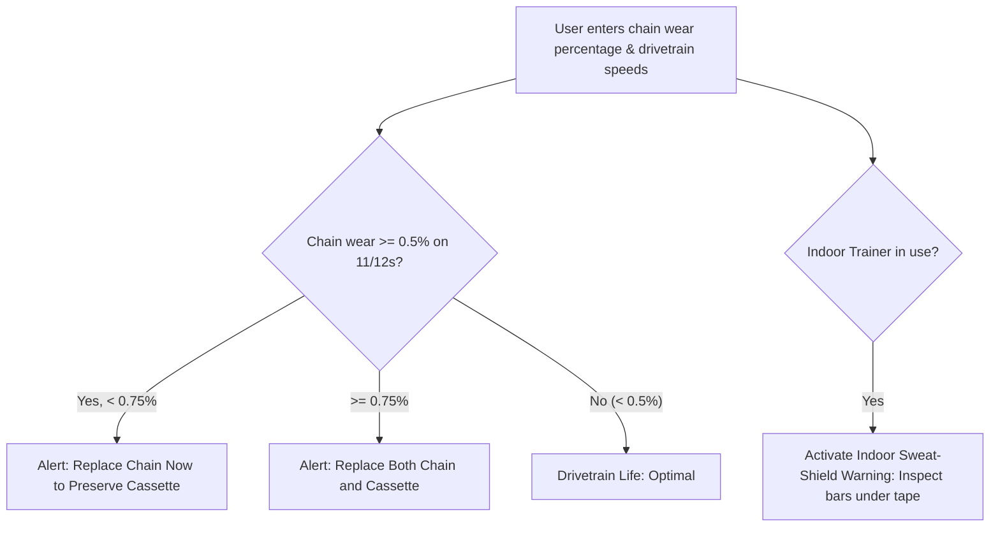

# Story 2.3: bAIkcare — Preventative Wear Tracking & Sweat Corrosion Shield

**Epic**: 2 (bAIkcare Engine — DIY Maintenance & Service)  
**Story ID**: 2.3  
**BUILDID**: CYCLE-1  
**Jira**: LOCAL  
**Author**: ANALYST_PM_GREENFIELD  
**Status**: Ready for Dev  

---

## User Flow & Journey

**User Journey**:
1. **Entry**: Cyclist wanting to check drivetrain life and protect equipment during trainer season opens the Wear Tracker.
2. **Inputs**: Enters chain tool gauge measurement (e.g. 0.25%, 0.5%, 0.75%), drivetrain speeds (10s, 11s, 12s), and indoor trainer usage frequency (yes/no).
3. **Logic Assessment**:
   - If chain wear $\ge 0.5\%$ on 11s/12s: Outputs "Replace Chain Immediately — Cassette Saved".
   - If chain wear $\ge 0.75\%$: Outputs "Mandatory Chain & Cassette Replacement".
   - If trainer usage = true: Activates the "Indoor Sweat Shield" alert warning of galvanic salt corrosion on aluminum handlebars under bar tape.



---

## 🤖 AI Agent Reference

### Acceptance Criteria
- [ ] **AC 2.3.1 (0.5% Threshold):** Accurately flags 0.5% wear on 11-speed and 12-speed systems as time for chain replacement.
- [ ] **AC 2.3.2 (0.75% Threshold):** Accurately flags $\ge 0.75\%$ wear with warning that cassette teeth have hooked and both chain and cassette must be replaced together.
- [ ] **AC 2.3.3 (Sweat Corrosion Protocol):** Displays actionable indoor trainer protection advice (use sweat guard towel, unwrap bar tape annually, blow-dry bearings with compressed air).
- [ ] **AC 2.3.4 (Zero Icons & Emojis):** Status tags rendered as clean monospace text badges.
- [ ] **AC 2.3.5 (Localization):** EN and CZ translations fully populated.

### Out of Scope ❌
- Direct Bluetooth connection to smart trainers (Wahoo/Tacx ANT+ API integration deferred).

### Localization Schema (EN / CZ)
```typescript
export const wearTrackingTranslations = {
  en: {
    title: 'Drivetrain Wear & Indoor Sweat Shield',
    chainWearLabel: 'Measured Chain Gauge Elongation (%)',
    speedsLabel: 'Drivetrain Speeds (e.g. 11s, 12s)',
    trainerLabel: 'Do you ride on an indoor trainer?',
    chainReplaceAlert: 'Service Alert: Chain wear has reached 0.5%. Replace chain now to prevent shark-finning cassette teeth.',
    bothReplaceAlert: 'Critical Alert: Chain wear exceeds 0.75%. You must replace both chain and cassette together.',
    sweatCorrosionAlert: 'Sweat Shield Alert: Electrolytic sweat salts corrode aluminum bars under bar tape. Unwrap and inspect your cockpit before seasonal road riding.',
  },
  cs: {
    title: 'Sledování opotřebení & Ochrana před potem',
    chainWearLabel: 'Naměřené prodloužení řetězu měrkou (%)',
    speedsLabel: 'Počet převodů (např. 11s, 12s)',
    trainerLabel: 'Jezdíte na trenažéru?',
    chainReplaceAlert: 'Servisní výstraha: Prodloužení řetězu dosáhlo 0.5 %. Vyměňte řetěz ihned, abyste zachránili kazetu a převodníky.',
    bothReplaceAlert: 'Kritická výstraha: Prodloužení přesáhlo 0.75 %. Je nutné vyměnit řetěz i kazetu současně.',
    sweatCorrosionAlert: 'Výstraha ochrany před potem: Soli z potu způsobují galvanickou korozi hliníkových řídítek pod omotávkou. Před sezónou odmotejte pásku a zkontrolujte povrch řídítek.',
  },
};
```
