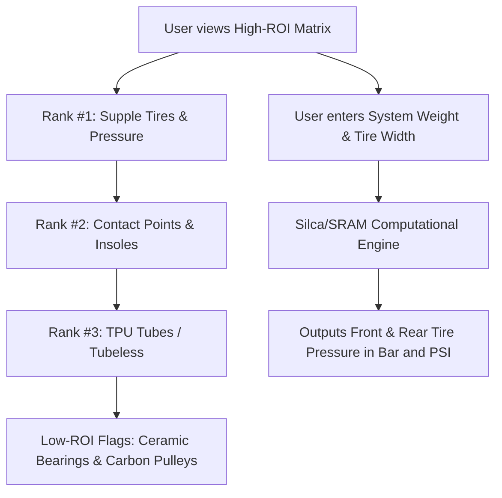

# Story 3.1: bAIkshop — High-ROI Upgrade Priority Matrix & Tire Pressure Calculator

**Epic**: 3 (bAIkshop Engine — Smart Upgrade & Component Advisory)  
**Story ID**: 3.1  
**BUILDID**: CYCLE-1  
**Jira**: LOCAL  
**Author**: ANALYST_PM_GREENFIELD  
**Status**: Ready for Dev  

---

## User Flow & Journey

**User Journey**:
1. **Entry**: Cyclist considering bike upgrades opens the Component Advisory module.
2. **Interactive Priority Matrix**:
   - **Rank #1 (Highest ROI):** Supple high-TPI tires (Continental GP5000 / Vittoria Corsa Pro) + optimal Silca-calculated tire pressure.
   - **Rank #2 (Ergonomic ROI):** Contact points (relief channel saddles $<145\text{mm}$, custom low-volume insoles like Soul G8, short-reach handlebars).
   - **Rank #3 (Rotational Mass ROI):** TPU inner tubes or tubeless conversion.
   - **Low-ROI Warning Guardrails:** Explicit warnings explaining why ceramic bearings ($<1\text{ W}$ gain) and oversized carbon pulley wheels are economically ineffective for non-professionals.
3. **Interactive Pressure Calculator**: Accepts Total System Weight (rider + bike) and Measured Tire Width (mm), generating exact front and rear tire pressures (in Bar and PSI).



---

## 🤖 AI Agent Reference

### Acceptance Criteria
- [ ] **AC 3.1.1 (Matrix Ranking Display):** Accurately orders upgrades by ROI (Tires > Contact Points > TPU > Low ROI).
- [ ] **AC 3.1.2 (Pressure Computation Formula):** Computes realistic road/gravel tire pressures based on system weight ($45\text{--}150\text{ kg}$) and tire width ($23\text{--}45\text{ mm}$), ensuring rear tire is $+0.2\text{--}0.3\text{ bar}$ higher than front.
- [ ] **AC 3.1.3 (Dual Unit Support):** Displays pressure simultaneously in `bar` and `psi`.
- [ ] **AC 3.1.4 (Low-ROI Warning Callout):** Includes explicit textual callout: "Ceramic bearings save only 0.5–1.0W while costing 10x more than standard steel bearings."
- [ ] **AC 3.1.5 (Zero Emojis & Icons):** Minimalist Google Material Design cards with bold typography hierarchy.
- [ ] **AC 3.1.6 (Localization):** 100% EN and CZ translation parity.

### Out of Scope ❌
- Direct payment gateway checkout (external affiliate/LBS redirect only).

### Localization Schema (EN / CZ)
```typescript
export const upgradeMatrixTranslations = {
  en: {
    title: 'High-ROI Upgrade Matrix & Pressure Calculator',
    rank1Title: '#1 Supple Tires & Optimal Pressure',
    rank1Desc: 'Top-tier high-TPI tires (Continental GP5000 / Vittoria Corsa Pro) provide the highest speed and comfort gain per dollar.',
    rank2Title: '#2 Contact Points & Custom Footbeds',
    rank2Desc: 'Relief-channel saddles (<145mm) and firm arch support (Soul G8) transfer 100% of leg power without numbness.',
    rank3Title: '#3 TPU Inner Tubes or Tubeless',
    rank3Desc: 'Massive rotational weight reduction and reduced rolling resistance compared to heavy butyl tubes.',
    lowRoiWarning: 'Warning: Ceramic bearings and oversized pulleys provide negligible gains (0.5–1W) at disproportionate costs.',
    pressureCalcTitle: 'Tire Pressure Calculator',
    systemWeightLabel: 'Total System Weight (Rider + Bike in kg)',
    tireWidthLabel: 'Measured Tire Width (mm)',
    frontPressure: 'Front Tire Pressure',
    rearPressure: 'Rear Tire Pressure',
  },
  cs: {
    title: 'Nákupní matice High-ROI & Kalkulátor tlaku',
    rank1Title: '#1 Poddajné pláště & Optimální tlak',
    rank1Desc: 'Špičkové pláště s vysokým TPI (Continental GP5000 / Vittoria Corsa Pro) přinášejí nejvyšší nárůst rychlosti a komfortu na investovanou korunu.',
    rank2Title: '#2 Kontaktní body & Ergonomické vložky',
    rank2Desc: 'Sedla s relief kanálkem (<145 mm) a pevné vložky s podporou klenby (Soul G8) přenesou 100 % síly bez bolesti.',
    rank3Title: '#3 TPU duše nebo Tubeless konverze',
    rank3Desc: 'Zásadní úspora obvodové rotující hmotnosti a nižší valivý odpor oproti těžkým butylovým duším.',
    lowRoiWarning: 'Varování: Keramická ložiska a karbonové kladky nabízejí zanedbatelnou úsporu (0.5–1 W) při neúměrně vysokých nákladech.',
    pressureCalcTitle: 'Kalkulátor ideálního tlaku v pláštích',
    systemWeightLabel: 'Celková hmotnost systému (Jezdec + Kolo v kg)',
    tireWidthLabel: 'Reálná šířka pláště (mm)',
    frontPressure: 'Tlak v předním plášti',
    rearPressure: 'Tlak v zadním plášti',
  },
};
```
