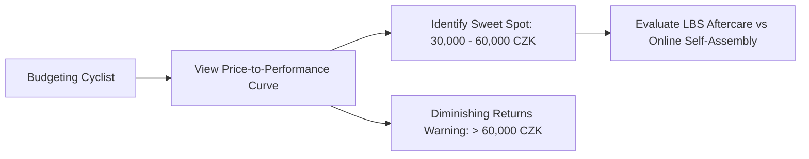

# Story 3.2: bAIkshop — Price Sweet Spot & Diminishing Returns Curve

**Epic**: 3 (bAIkshop Engine — Smart Upgrade & Component Advisory)  
**Story ID**: 3.2  
**BUILDID**: CYCLE-1  
**Jira**: LOCAL  
**Author**: ANALYST_PM_GREENFIELD  
**Status**: Ready for Dev  

---

## User Flow & Journey

**User Journey**:
1. **Entry**: Cyclist budgeting for a new bike or major component upgrade opens the Price Sweet Spot analyzer.
2. **Interactive Curve**:
   - Displays the Economic Value vs. Cost Curve.
   - Highlights the **Optimal Sweet Spot region (£1,000–£2,000 / ~30,000–60,000 CZK)** where riders obtain hydraulic disc brakes, reliable mid-tier groupsets (Shimano 105 / GRX), and modern frame geometry.
   - Highlights the **Diminishing Returns Zone (> £2,000)** where additional spending yields only marginal weight savings (grams) and aesthetic integration rather than transformative performance or safety gains.
3. **Local Bike Shop (LBS) vs. Online Factor**: Outlines the true cost calculation (aftercare, warranty, assembly costs when bringing internet-bought parts to local workshops).



---

## 🤖 AI Agent Reference

### Acceptance Criteria
- [ ] **AC 3.2.1 (Sweet Spot Visualization):** Clearly marks the £1,000–£2,000 / 30,000–60,000 CZK range as the peak value-to-cost zone.
- [ ] **AC 3.2.2 (Diminishing Returns Explanation):** Educational copy explains that above £2,000, spending pays for grams and electronic integration, not exponential safety or speed.
- [ ] **AC 3.2.3 (LBS Partnership Insight):** Explains the financial advantage of local workshop warranty and aftercare support.
- [ ] **AC 3.2.4 (Design Constraints):** Clean Google Material Design 3 cards; zero decorative icon containers or emojis.
- [ ] **AC 3.2.5 (Localization):** Complete EN and CZ parity.

### Out of Scope ❌
- Live scraped pricing comparisons from third-party retailer APIs.

### Localization Schema (EN / CZ)
```typescript
export const sweetSpotTranslations = {
  en: {
    title: 'Price Sweet Spot & Diminishing Returns',
    curveSubtitle: 'Where your cycling investment delivers maximum performance and safety.',
    sweetSpotTitle: 'The Sweet Spot: £1,000 – £2,000 (~30,000 – 60,000 CZK)',
    sweetSpotDesc: 'In this range, you get hydraulic disc brakes, reliable 11/12-speed drivetrains (Shimano 105/GRX), and durable tubeless-ready wheelsets.',
    diminishingTitle: 'Zone of Diminishing Returns (> £2,000 / 60,000 CZK)',
    diminishingDesc: 'Beyond this point, each additional dollar buys only marginal weight savings (grams) and aesthetic cable integration rather than foundational speed or comfort.',
    lbsFactorTitle: 'Local Bike Shop (LBS) vs. Online Reality',
    lbsFactorDesc: 'Factoring in warranty support, free initial tune-ups, and workshop labor often makes local shop purchases more economical than direct internet imports.',
  },
  cs: {
    title: 'Cenový Sweet Spot & Křivka klesajících výnosů',
    curveSubtitle: 'Kde vaše investice do cyklistiky přináší maximální užitnou hodnotu a bezpečnost.',
    sweetSpotTitle: 'Cenový Sweet Spot: 30 000 – 60 000 Kč (£1,000 – £2,000)',
    sweetSpotDesc: 'V tomto rozmezí získáte hydraulické kotoučové brzdy, spolehlivou sadu (Shimano 105/GRX) a odolná kola připravená na bezdušový provoz.',
    diminishingTitle: 'Zóna klesajících výnosů (> 60 000 Kč)',
    diminishingDesc: 'Nad touto hranicí už neplatíte za skokový nárůst bezpečí či rychlosti, ale za minimální gramové úspory, skrytou kabeláž a custom design.',
    lbsFactorTitle: 'Kamenný servis (LBS) vs. Nákup z e-shopu',
    lbsFactorDesc: 'Garanční servis, okamžité vyřízení reklamací a odborná montáž v LBS často smažou papírový cenový rozdíl oproti internetovým e-shopům.',
  },
};
```
